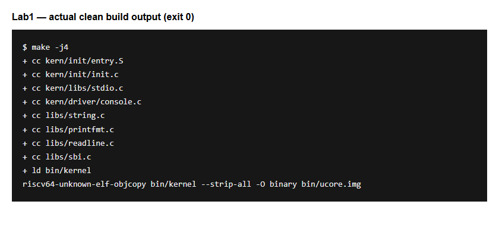

# 操作系统实验报告

## 实验基本信息

| 项目 | 内容 |
|------|------|
| **实验名称** | Lab 1: [最小可执行内核] |
| **小组成员** | 2413646-秦紫轩、2412933-李易桐、2413524-洪若曦 |
| **完成日期** | 2026-10-9 |

### 小组分工

共同都将ucore跑起来了，了解了完整过程。

| 成员 | 负责的练习/模块 |
|------|----------------|
| 2413646-秦紫轩 | [报告撰写] |
| 2413524-洪若曦 | [练习1] |
| 2412933-李易桐 | [练习2] |

---

## 一、实验目的

<!-- 说明本次实验的主要目标和预期成果 -->
实验1主要讲解最小可执行内核和启动流程。我们的内核主要在 Qemu 模拟器上运行，它可以模拟一台 64 位 RISC-V 计算机。为了让我们的内核能够正确对接到 Qemu 模拟器上，需要了解 Qemu 模拟器的启动流程，还需要一些程序内存布局和编译流程（特别是链接）相关知识。

本实验的主要目的是：

1. 使用链接脚本描述内存布局。
2. 通过交叉编译生成可执行文件和内核镜像。
3. 通过 QEMU/GDB 验证从复位到内核执行的过程，使用 OpenSBI 完成内核启动交接，解释入口建栈及跳转操作。
4. 使用 OpenSBI 服务格式化输出字符串，为后续调试提供支持。


---

## 二、实验环境

你们使用的 AI 工具

| 成员 | AI 编程工具 | 底层模型 | 备注 |
|------|------------|---------|------|
| 2413646-秦紫轩 | ChatGPT（VS Code 插件） | ChatGPT 6.1 Sol | |
| 2412933-李易桐 | ChatGPT（VS Code 插件） | ChatGPT 6.1 Sol | |
| 2413524-洪若曦 | ChatGPT（VS Code 插件） | ChatGPT 6.1 Sol | |

**说明：**
- **AI 编程工具**：指具体使用的终端工具、编辑器插件、桌面应用或浏览器界面
- **底层模型**：指该工具使用的大语言模型及版本

---

## 三、实验整体逻辑分析

### 2.1 本章节的逻辑主线

本章围绕“内核如何开始执行”展开，实现了从复位到内核执行的过程：交叉编译生成镜像，链接脚本确定入口，QEMU 装入镜像，CPU 经复位 ROM、OpenSBI 到达内核，随后建栈并进入 C 初始化代码。过程中熟悉了GDB 的调试方法。

### 2.2 功能的逐步实现

1. 首先完成**内存布局与镜像生成** → 用链接脚本确定入口 `0x80200000`，交叉编译生成内核镜像，为启动提供可执行代码。
2. 接着配置**固件与内核启动** → QEMU 装入镜像，OpenSBI 完成初始化并交接控制权，使 CPU 开始执行内核。
3. 然后核对**内核初始化与输出** → 先建立栈，再清零 BSS、打印启动信息，为 C 代码提供运行环境并确认启动成功。
4. 最后进行**GDB 启动验证** → 用断点和单步观察复位、固件、内核入口，核对启动过程及首条指令的执行结果。

---

## 四、实验内容与实现

<!-- 
说明：本部分按照 exercises 文档中的练习顺序组织
每个功能模块或者练习中可能包含多项任务，请根据实际情况调整
-->

### 功能模块：最小内核启动与输出

**负责人：** 小组成员

#### 模块功能描述

**主要功能函数：**

```c
int kern_init(void) __attribute__((noreturn));
int cprintf(const char *fmt, ...);
int vcprintf(const char *fmt, va_list ap);
void vprintfmt(void (*putch)(int, void *), void *putdat,
              const char *fmt, va_list ap);
static void cputch(int c, int *cnt);
void cons_putc(int c);
void sbi_console_putchar(unsigned char ch);
uint64_t sbi_call(uint64_t sbi_type, uint64_t arg0,
                  uint64_t arg1, uint64_t arg2);
```

以上均为已有函数，本次未修改其实现。

**功能说明：**

1. **链接与启动交接：** `tools/kernel.ld` 用 `ENTRY(kern_entry)` 指定入口，以 `BASE_ADDRESS = 0x80200000` 排布代码、只读数据、数据和 BSS，数据段按 4 KB 对齐。QEMU 预先装入固件和内核镜像；CPU 从复位地址 `0x1000` 执行，经 `0x80000000` 的 OpenSBI 初始化后，进入 `0x80200000` 的内核入口。
2. **建立内核运行环境：** `entry.S` 中的 `kern_entry` 通过 `la sp, bootstacktop` 建立 8 KB 启动栈，再用 `tail kern_init` 跳转到 C 入口。`kern_init` 依据链接脚本的 `edata`、`end`，调用 `memset` 清零 BSS，然后调用 `cprintf` 打印启动信息。
3. **stdio 解析格式字符串：** `cprintf` 用 `va_start` 初始化可变参数列表，调用 `vcprintf`，再由 `vprintfmt` 解析格式字符串。对于每个待输出字符，`vprintfmt` 调用回调 `cputch`。
4. **将字符交给 SBI：** `cputch` 调用 `cons_putc` 并累计字符数；`cons_putc` 再调用 `sbi_console_putchar`，后者调用 `sbi_call`，传入字符输出服务编号 `1` 和待输出字符。
5. **内联汇编输出并返回：** `sbi_call` 用 `__asm__ volatile` 将服务编号放入 `a7`（`x17`），参数放入 `a0`～`a2`（`x10`～`x12`），执行 `ecall` 请求 OpenSBI 输出字符，并从 `a0` 取回返回值。输入、输出约束连接 C 变量与汇编操作，`memory` 声明可能影响内存。调用返回后继续处理剩余字符；全部输出完成后，`cprintf` 执行 `va_end` 并返回，`kern_init` 才进入 `while (1)` 循环。

启动信息的完整调用链为：

```text
cprintf → vcprintf → vprintfmt → cputch → cons_putc
        → sbi_console_putchar → sbi_call → ecall → OpenSBI
```

#### 最终提示词

复现运行的过程较为顺利，以下为GDB调试提示词：

````markdown
[PROMPT]
分析 Lab1 的入口代码，核对 QEMU 启动参数，使用 GDB 验证启动流程。

[RELY]
读取 Makefile、tools/kernel.ld、kern/init/entry.S 和 kern/init/init.c。
链接入口为 0x80200000；入口先建栈，再跳转到 kern_init。
练习二环境为 QEMU 7.0.0、OpenSBI v1.0，已有启动日志和 GDB 截图。

[GUARANTEE]
不新增内核函数，保留已有实现；给出启动参数修正及调试步骤。

[SPECIFICATION]
前置条件：内核可编译，QEMU 支持 GDB 远程调试。
后置条件：出现内核启动输出，并验证复位、固件和内核入口。
异常情况：若仅显示 OpenSBI，检查交接地址与镜像加载参数。
验证要求：入口断点命中后再执行 si，检查 PC 和 SP；如实记录失败项。
````

#### 实现迭代过程

本模块有两轮：启动配置和 GDB 调试。

---

##### 第一次迭代

**遇到的问题：**

- 启动仅显示 OpenSBI，Next Address 为零，未进入内核。

**问题解决策略：**

- 反馈实际环境和启动日志，核对 Makefile；将 QEMU 变量改为 `qemu-system-riscv64`。
- 将 `qemu`、`debug` 的加载参数改为 `-kernel $(UCOREIMG)`，向当前动态固件提供内核交接地址。

**最终结果：**

编译通过，`make qemu` 输出 `(THU.CST) os is loading ...`，截图显示交接地址为 `0x80200000`、模式为 S-mode。

**关键改进点总结（如有）：**

注意执行目录、当前 QEMU/OpenSBI 版本等匹配。

---

##### 第二次迭代

**遇到的问题：**

- 多行粘贴 GDB 命令出现 `"on" or "off" expected.`。


**问题解决策略：**

- 反馈错误输出，改为逐条输入命令并回车。

**最终结果：**

逐条输入后，反汇编和单步命令正常执行。到达内核入口后执行 `si`，观察到 `pc = 0x80200004`、`sp = 0x80203000`，确认首条机器指令已执行。

**关键改进点总结（如有）：**

一次一次来，主要需要逐步用寄存器数值核对指令效果。

---


### 练习 1：理解内核启动中的程序入口操作
* 阅读 kern/init/entry.S内容代码，结合操作系统内核启动流程，说明指令 la sp, bootstacktop 完成了什么操作，目的是什么？ tail kern_init 完成了什么操作，目的是什么？ *

`la sp, bootstacktop` 将启动栈顶地址写入 `sp`（`x2`）。启动栈大小为 `2 × 4096 = 8192` 字节，地址范围为 `0x80201000` 至 `0x80203000`，栈向低地址增长。进入 C 函数前设置合法栈，用于函数调用、寄存器保存和局部变量。

**目的：** 为内核建立自己的合法启动栈，使后续 C 代码能够按调用约定进行函数调用、保存寄存器和存放局部变量。

本次反汇编为：

```asm
0x80200000: auipc sp,0x3
0x80200004: mv    sp,sp
0x80200008: j     0x8020000a <kern_init>
```

第一条计算 `sp = 0x80200000 + (0x3 << 12) = 0x80203000`；低位偏移为零，第二条等价于 `addi sp,sp,0`。

`tail kern_init` 跳转到 C 入口，不设置新的返回地址。本次表现为直接跳转；`kern_init` 标记为 `noreturn`，清零 BSS、输出启动信息后无限循环，无需返回入口汇编。

**目的：** 将控制权从汇编入口交给内核的 C 初始化函数；该函数不会返回，因此采用尾跳转，无需设置返回地址。

### 练习 2：使用 GDB 验证启动流程

在 `code/` 下，两个终端分别运行 `make debug`、`make gdb`。`-s` 开启端口 1234，`-S` 暂停 CPU；GDB 加载 `bin/kernel` 的符号并连接 QEMU。

按顺序执行：

```gdb
x/6i $pc
si 6
info registers pc
x/4i $pc
hbreak *0x80200000
continue
x/6i $pc
si
info registers pc sp
```

**复位阶段：** PC 初值为 `0x1000`，最初六条指令如下。

| 地址 | 指令 | 功能 |
|---|---|---|
| `0x1000` | `auipc t0,0x0` | 取得 PC，作为寻址基准 |
| `0x1004` | `addi a2,t0,40` | 指向动态固件信息 |
| `0x1008` | `csrr a0,mhartid` | 读取硬件线程编号 |
| `0x100c` | `ld a1,32(t0)` | 读取设备树地址 |
| `0x1010` | `ld t0,24(t0)` | 读取 OpenSBI 入口 `0x80000000` |
| `0x1014` | `jr t0` | 跳转到固件 |


**固件阶段：** `si 6` 后 PC 为 `0x80000000`，前三条指令将 `a0`、`a1`、`a2` 保存到 `s0`、`s1`、`s2`，随后进入固件初始化。


**内核阶段：** 继续执行命中 `0x80200000` 断点，定位到 `kern_entry`。再执行一次 `si`，得到 `pc = 0x80200004`、`sp = 0x80203000`，证明内核第一条机器指令已经执行。


总上，本次启动路径为 `0x1000`（复位 ROM）→ `0x80000000`（OpenSBI）→ `0x80200000`（内核）。

---


---

## 五、测试与验证

<!-- 根据该实验的具体情况，提供完整的测试运行截图，应包含：
- 编译及运行成功的输出（make qemu），可能有多个
- 测试通过的结果（make grade），只有一个
-->

**测试截图：**

Ubuntu 20.04、GCC 10.2.0：




| 验证项 | 结果 |
|---|---|
| `make` / `make qemu` | 生成内核镜像，输出 `(THU.CST) os is loading ...` |
| 启动交接 | 截图显示 Next Address 为 `0x80200000`、Next Mode 为 S-mode |
| GDB 单步 | 验证复位、固件、内核入口及首条指令执行后的 PC/SP |
| `make grade` | 本机实测退出码 2：`Can't open tools/grade.sh`；原始代码包及仓库均缺少该脚本 |


---

## 六、实验总结与收获

### 对操作系统的理解

1. **系统启动与引导：** ROM、OpenSBI 和内核逐级交接控制权。
2. **程序布局与装入：** 链接地址必须与执行地址一致。本实验使用 ELF 中的符号调试，使用原始镜像加载运行。
3. **运行时初始化：** 入口汇编先建立启动栈，C 入口再清零 BSS，为函数调用和静态变量提供正确的初始状态。 内核栈用于存放内核函数的局部变量、需要保存的寄存器和返回地址。本实验在数据段中静态预留 2 页（8 KB）作为启动栈，将 `sp` 指向 `bootstacktop`；栈向低地址增长，为进入 C 代码后的函数调用提供空间。这里使用的是启动栈，尚未涉及为进程分配内核栈及上下文切换时的栈切换。
4. **特权级与保护：** RISC-V 通过 CPU 特权级划分执行权限，M、S、U 模式的权限由高到低。M 模式用于底层固件，控制机器级配置；S 模式通常运行操作系统内核，管理内存和进程；U 模式运行应用程序，限制其访问系统资源。低特权代码不能任意执行高特权指令或访问高特权寄存器，需要经系统调用、SBI 等受控接口请求服务，从而隔离应用与内核，保护系统资源。本实验中，OpenSBI 在 M 模式运行，内核在 S 模式运行；内核执行 `ecall` 请求 SBI 服务，进入 M 模式固件，处理后通过 `mret` 返回 S 模式继续执行。当前实验尚未运行 U 模式程序。


### AI 协作开发的经验

1. 注意用源码、反汇编和寄存器结果核对 AI 的解释，单纯看解释理解不深入，也不能保证正确。
2. 保留失败反馈和修正过程，按实际结果判断是否完成验证。

---

