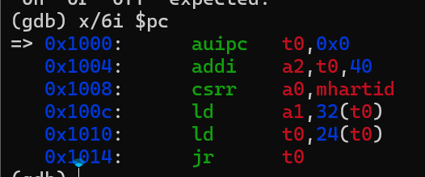
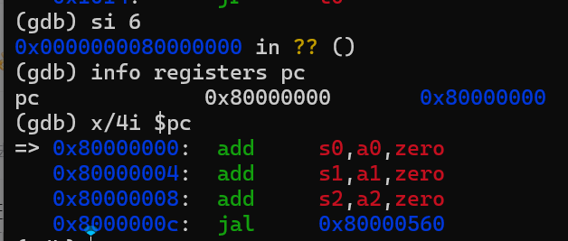
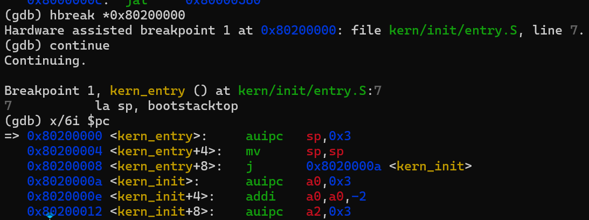
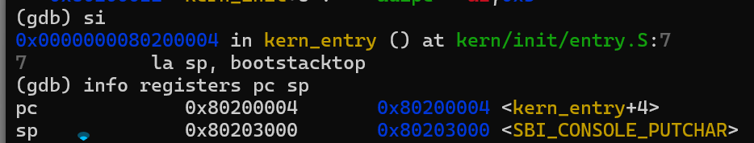
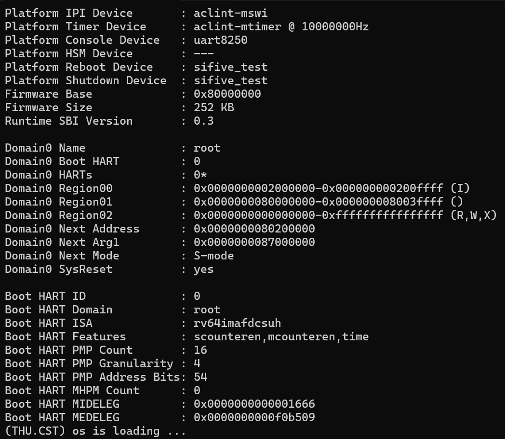

# 操作系统实验报告

> 第一版：模板提示、示例及原有内容均保留；未填写的示例不代表实测结果。新增内容依据练习记录和仓库截图整理。

基于 markdown 格式完成实验报告，以文本说明为主。
说明自己对本章节整体逻辑线的理解，即本章节是按照什么顺序、围绕哪些功能逐步实现的。
说明自己对每个功能的核心函数或功能模块的理解。
列出你认为本实验中重要的知识点，以及与对应 OS 原理中的知识点，并简要说明二者的含义、关系和差异。
列出你认为 OS 原理中很重要、但在本实验中没有对应上的知识点。
## 实验基本信息

| 项目 | 内容 |
|------|------|
| **实验名称** | Lab 1: [最小可执行内核] |
| **小组成员** | 2413646-秦紫轩、2412933-李易桐、2413524-洪若曦 |
| **完成日期** | 2026-10-9 |

### 小组分工

练习如何分工？

| 成员 | 负责的练习/模块 |
|------|----------------|
| 2413646-秦紫轩 | [报告撰写] |
| 2412933-李易桐 | [练习1] |
| 2413524-洪若曦 | [练习2] |

实验报告如何分工？

秦紫轩整理报告；练习负责人存在记录差异，以上分工待小组确认。

---

## 一、实验目的

<!-- 说明本次实验的主要目标和预期成果 -->
实验1主要讲解最小可执行内核和启动流程。我们的内核主要在 Qemu 模拟器上运行，它可以模拟一台 64 位 RISC-V 计算机。为了让我们的内核能够正确对接到 Qemu 模拟器上，需要了解 Qemu 模拟器的启动流程，还需要一些程序内存布局和编译流程（特别是链接）相关知识。

本章你将学到：

使用 链接脚本 描述内存布局

进行 交叉编译 生成可执行文件，进而生成内核镜像

使用 OpenSBI 作为 bootloader 加载内核镜像，并使用 Qemu 进行模拟

使用 OpenSBI 提供的服务，在屏幕上格式化打印字符串用于以后调试
本实验的主要目的是：

1. [目的1：例如，理解用户态进程如何通过系统调用进入内核]
2. [目的2：例如，掌握进程创建、执行、退出的完整生命周期]
3. [目的3：例如，学习使用 AI 辅助开发操作系统核心功能]

本次目标：理解链接与内存布局，解释入口建栈及跳转操作，通过 QEMU/GDB 验证从复位到内核执行的过程。

---

## 二、实验环境

你们使用的 AI 工具

| 成员 | AI 编程工具 | 底层模型 | 备注 |
|------|------------|---------|------|
| 2413646-秦紫轩 | [例如：Cline（VS Code插件） / Claude Code（终端 Agent） / DeepSeek Harness等] | [例如：Claude Sonnet 4.5 / GPT-5.5 / DeepSeek-V4-Flash等] | [可选：特殊配置等] |
| 2412933-李易桐 | | | |
| 2413524-洪若曦 | | | |

**说明：**
- **AI 编程工具**：指具体使用的终端工具、编辑器插件、桌面应用或浏览器界面
- **底层模型**：指该工具使用的大语言模型及版本

| 环境 | 系统 | RISC-V GCC / GDB | QEMU / OpenSBI |
|---|---|---|---|
| 本机环境验证 | WSL 2、Ubuntu 20.04.3 | 10.2.0 / 10.1 | 4.1.1 / v0.4 |
| 练习二截图环境 | WSL 2、Ubuntu 22.04.5 | 15.1.0 / 16.3.90.20250610-git | 7.0.0 / v1.0 |

本机工具位于 `/opt/riscv`，代码位于 `D:\OS-Lab\projects\lab1`；仓库代码位于 `code/`。练习二记录使用 ChatGPT（记录标注为 6.1 Sol）；本次报告整理使用 Codex，其余工具信息待补充。

---

## 三、实验整体逻辑分析

### 2.1 本章节的逻辑主线

[请用自己的话描述本章实验的核心主线，例如：
- 本章围绕哪个核心主题展开？（例如：用户进程管理、虚拟内存、文件系统等）
- 整个实验解决什么问题？（例如：如何让用户程序运行在操作系统之上）]

本章围绕“内核如何开始执行”展开：交叉编译生成镜像，链接脚本确定入口，QEMU 装入镜像，CPU 经复位 ROM、OpenSBI 到达内核，随后建栈并进入 C 初始化代码。

### 2.2 功能的逐步实现

[说明本章实验是按照什么顺序逐步实现各个功能的，以及为什么要按这个顺序，例如：

1. 首先实现**功能A** → 为什么首先实现这个？（例如：建立系统调用接口是后续所有用户态功能的基础）
2. 接着再完善**功能B** → 为什么接着实现这个？（例如：有了系统调用后，需要能够加载和启动第一个用户进程）
3. 然后完成**功能C** → 为什么然后实现这个？（例如：有了第一个进程后，需要实现进程复制功能）
4. 最后补充了**功能D** → 为什么最后实现这个？（例如：最后完善进程退出和清理机制，形成完整闭环）]

实际顺序为：确定 `0x80200000` 的链接布局 → 编译、链接并生成镜像 → 配置 QEMU 启动 → 入口建栈、清零 BSS、打印信息 → 用 GDB 核对交接地址。前一步提供后一步运行所需的地址或执行环境。

---

## 四、实验内容与实现

<!-- 
说明：本部分按照 exercises 文档中的练习顺序组织
每个功能模块或者练习中可能包含多项任务，请根据实际情况调整
-->

### 功能模块：[模块名称]

**负责人：** [学号-姓名]

#### 模块功能描述

**需要实现/修改的函数：**

```c
// 列出本模块涉及的所有函数签名
void example_function(void);
int another_function(int arg);
```

**功能说明：**

[简要描述该模块的功能，包括：
- 该模块在整个系统中的作用
- 需要处理的主要场景
- 与其他模块的交互关系]

**实际模块：最小内核启动与输出。** 本次未新增内核函数；练习二修正了 `code/Makefile` 的启动参数。

| 核心入口或函数 | 作用 |
|---|---|
| `kern_entry`（汇编标签） | 设置启动栈，跳转到 `kern_init` |
| `int kern_init(void)`（`noreturn`） | 清零 BSS，打印启动信息后循环 |
| `int cprintf(const char *fmt, ...)` | 格式化输出，经 `cons_putc`、SBI `ecall` 请求固件输出字符 |
| `kernel.ld` / Makefile | 确定入口与段布局，完成编译、链接及镜像装入 |

#### 最终提示词

以下是经过迭代优化后，最终成功实现该功能的提示词：

````markdown

[按照提示词模板，给出具体的提示词]

````

实际协作采用连续问答，未使用上面的模板提示词。练习一围绕入口指令和地址计算提问；练习二反馈编译输出、启动日志及 GDB 截图，逐步定位问题。

#### 实现迭代过程

本模块的实现经历了 [N] 次迭代，过程如下：

---

##### 第一次迭代

如果设计的prompt生成代码后出现问题：

**遇到的问题：**
- 问题1：问题描述、错误信息和原因分析
- 问题2：问题描述、错误信息和原因分析

**问题解决策略：**
- 针对问题1：[说明如何修改提示词]
- 针对问题2：[说明如何修改提示词]

如果没有问题：

**最终结果：**

经过 [N] 次迭代，该模块最终：
- ✅ 编译通过
- ✅ 所有相关测试通过
- ✅ 功能符合预期

**关键改进点总结（如有）：**
1. [改进点1：例如，在 [RELY] 中补充了完整的系统调用号定义]
2. [改进点2：例如，在 [SPECIFICATION] 中明确了异常处理的边界条件]
3. [改进点3：例如，增加了对用户指针合法性检查的要求]

**实际迭代：** 启动时仅显示 OpenSBI，检查发现 QEMU 变量指向目录，且当前动态固件未得到内核交接地址。将变量改为 `qemu-system-riscv64`，并将 `qemu`、`debug` 的加载参数改为 `-kernel $(UCOREIMG)`，随后出现内核输出。

---

##### 第二次迭代（如有）

[按照和第一次迭代相同的格式]

**实际调试修正：** 多行粘贴 GDB 命令出现 `"on" or "off" expected.`，改为逐条输入。入口断点只证明到达内核，补充一次 `si` 才验证第一条机器指令已执行。

---

##### 第三次迭代（如有）

[按照和第一次迭代相同的格式]

未记录额外迭代。编译、启动和 GDB 观察通过；评分测试因缺少脚本未通过。

---

### 练习：[练习标题]

**负责人：** [学号-姓名]

[按照练习的具体要求进行解答]

### 练习 1：理解内核入口操作

`la sp, bootstacktop` 将启动栈顶地址写入 `sp`（`x2`）。启动栈大小为 `2 × 4096 = 8192` 字节，地址范围为 `0x80201000` 至 `0x80203000`，栈向低地址增长。进入 C 函数前设置合法栈，用于函数调用、寄存器保存和局部变量。

本次反汇编为：

```asm
0x80200000: auipc sp,0x3
0x80200004: mv    sp,sp
0x80200008: j     0x8020000a <kern_init>
```

第一条计算 `sp = 0x80200000 + (0x3 << 12) = 0x80203000`；低位偏移为零，第二条等价于 `addi sp,sp,0`。

`tail kern_init` 跳转到 C 入口，不设置新的返回地址。本次表现为直接跳转；`kern_init` 标记为 `noreturn`，清零 BSS、输出启动信息后无限循环，无需返回入口汇编。

### 练习 2：使用 GDB 验证启动流程

在 `code/` 下，两个终端分别运行 `make debug`、`make gdb`。`-s` 开启端口 1234，`-S` 暂停 CPU；GDB 加载 `bin/kernel` 的符号并连接 QEMU。

按顺序执行：

```gdb
x/6i $pc
si 6
info registers pc
x/4i $pc
hbreak *0x80200000
continue
x/6i $pc
si
info registers pc sp
```

**复位阶段：** PC 初值为 `0x1000`，最初六条指令如下。

| 地址 | 指令 | 功能 |
|---|---|---|
| `0x1000` | `auipc t0,0x0` | 取得 PC，作为寻址基准 |
| `0x1004` | `addi a2,t0,40` | 指向动态固件信息 |
| `0x1008` | `csrr a0,mhartid` | 读取硬件线程编号 |
| `0x100c` | `ld a1,32(t0)` | 读取设备树地址 |
| `0x1010` | `ld t0,24(t0)` | 读取 OpenSBI 入口 `0x80000000` |
| `0x1014` | `jr t0` | 跳转到固件 |



**固件阶段：** `si 6` 后 PC 为 `0x80000000`，前三条指令将 `a0`、`a1`、`a2` 保存到 `s0`、`s1`、`s2`，随后进入固件初始化。



**内核阶段：** 继续执行命中 `0x80200000` 断点，定位到 `kern_entry`。再执行一次 `si`，得到 `pc = 0x80200004`、`sp = 0x80203000`，证明内核第一条机器指令已经执行。





因此，本次启动路径为 `0x1000`（复位 ROM）→ `0x80000000`（OpenSBI）→ `0x80200000`（内核）。这些地址属于本实验平台。QEMU 在 CPU 执行前通过 `-kernel` 装入镜像；本次未使用写监视点观察装入过程，也未逐条执行全部 OpenSBI 代码。

---

### Challenge：[Challenge标题]

**负责人：** [学号-姓名]

[按照Challenge的具体要求进行解答]

本次指导书未设置 Challenge。

---

## 五、测试与验证

<!-- 根据该实验的具体情况，提供完整的测试运行截图，应包含：
- 编译及运行成功的输出（make qemu），可能有多个
- 测试通过的结果（make grade），只有一个
-->

**测试截图：**


上图为保留的模板占位引用，尚未提供对应文件。实际启动截图如下：



| 验证项 | 结果 |
|---|---|
| `make` / `make qemu` | 生成内核镜像，输出 `(THU.CST) os is loading ...` |
| 启动交接 | 截图显示 Next Address 为 `0x80200000`、Next Mode 为 S-mode |
| GDB 单步 | 验证复位、固件、内核入口及首条指令执行后的 PC/SP |
| `make grade` | 本机实测退出码 2：`Can't open tools/grade.sh`；原始代码包及仓库均缺少该脚本 |

输出后停止更新是 `while (1)` 的预期行为。上述 GDB 截图来自练习二环境；本机 GCC 10.2.0/QEMU 4.1.1 也已完成编译及启动验证。

---

## 六、实验总结与收获

### 对操作系统的理解

1. 列出你们认为本实验中重要的知识点，以及与对应的 OS 原理中的知识点，并简要说明二者的含义、关系和差异
2. 列出你们认为 OS 原理中很重要、但在本实验中没有对应上的知识点

| 实验知识点 | 对应 OS 原理及实验范围 |
|---|---|
| ROM → 固件 → 内核 | 系统引导：分阶段准备环境并交接控制权；本次镜像由 QEMU 预加载 |
| 链接脚本、ELF 与镜像 | 程序布局与装入：链接地址必须匹配执行地址；ELF 保留符号供调试，原始镜像用于运行 |
| 启动栈与 BSS 清零 | 运行时初始化：先建立栈、初始化静态存储，再执行 C 代码；尚未涉及进程上下文切换 |
| M/S 模式与 SBI | 特权级与保护：固件和内核分工，内核经 SBI 请求固件服务 |
| PC、断点与单步 | 指令执行：到达入口与执行完入口指令是不同状态 |

本实验尚未涉及进程调度、页表与虚拟内存、完整异常处理、文件系统及用户态系统调用。

### AI 协作开发的经验

[写出你们在与 AI 协作过程中实际收获的经验或者感悟]

提供版本、命令和完整输出，比只描述“没有反应”更便于定位问题。AI 解释需要用源码、反汇编和寄存器结果核对，尤其要区分镜像装入与开始执行，以及模板示例与实测结果。

指导书：[Lab1 练习](http://oslab.mobisys.top/lab2026/_book/lab1/lab1_2_1_exercise.html)、[报告要求](http://oslab.mobisys.top/lab2026/_book/lab1/lab1_5_requirement.html)。

---

