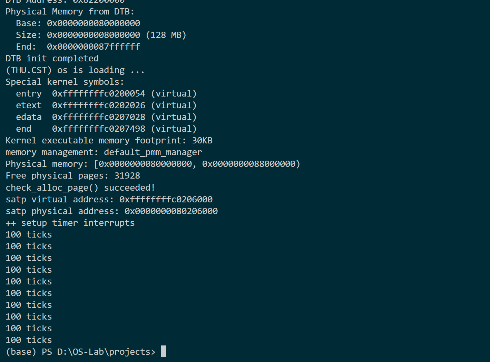
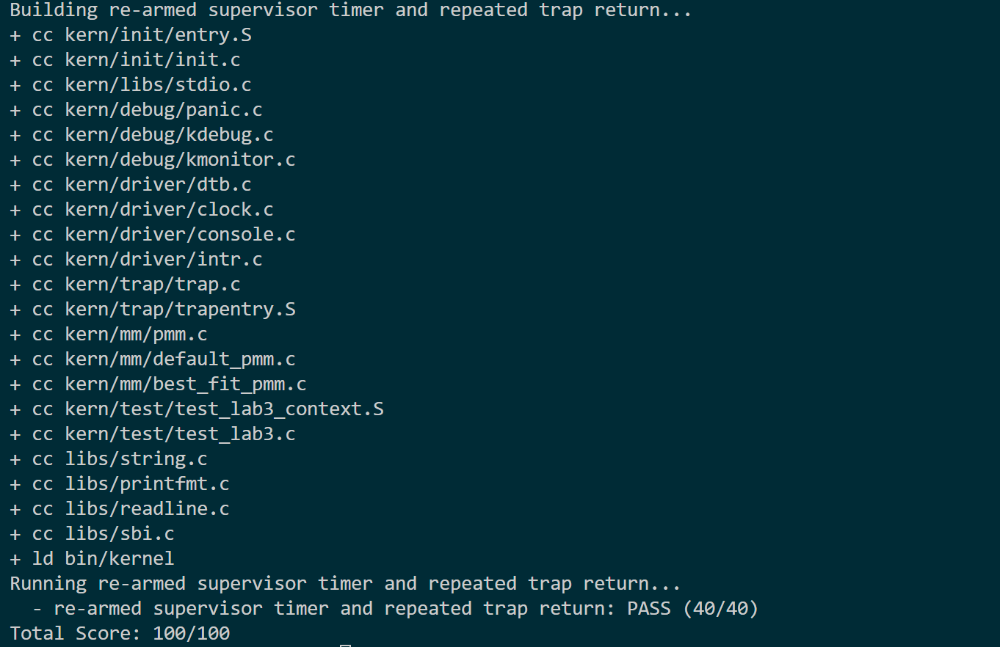

# 操作系统实验报告

## 实验基本信息

| 项目 | 内容 |
|------|------|
| **实验名称** | Lab 3：中断与异常处理 |
| **小组成员** | 2413646-秦紫轩、2412933-李易桐、2413524-洪若曦 |
| **完成日期** | 2026-11-07 |

### 小组分工

| 成员 | 负责的模块 |
|------|----------------|
| 2412933-李易桐（A） | 补全 `__alltraps` 与 `RESTORE_ALL` 以及其他入口配置|
| 2413524-洪若曦（B） | 实现 `interrupt_handler()`，完成中断分派与处理；分析中断使能、状态保存与恢复、页管理临界区及宏的写法。 |
| 2413646-秦紫轩（C） | 实现 `exception_handler()`，处理非法指令、断点及其他异常；补齐累计输出后关机逻辑，完成整体测试及报告撰写。 |

---

## 一、实验目的

本实验完成 RISC-V S 态中断与异常的处理，理解硬件记录 Trap 状态、汇编保存现场、C 函数分派处理以及恢复执行之间的关系。

主要目标如下：

1. 理解 `stvec`、`sstatus`、`sepc`、`scause`、`stval` 在 Trap 进入与返回过程中的作用。
2. 依据 `struct trapframe` 的布局补全汇编入口与现场恢复，使 C 处理函数能够接收并修改 Trap frame。
3. 实现持续时钟中断，维护 `ticks`，按规定间隔输出统计信息，并在累计输出达到配置阈值后关机。
4. 识别非法指令和断点异常，根据指令编码正确推进 `tf->epc`，避免返回后重复触发同一异常；对其他异常保留现场诊断输出。
5. 通过正常启动和现有评分脚本验证各模块整合后的行为。

---

## 二、实验环境

### 2.1 构建与运行环境


| 项目 | 配置 |
|------|------|
| Linux 系统 | Ubuntu 20.04.3 LTS |
| 目标平台 | QEMU `virt`，64 位 RISC-V |
| 交叉编译器 | `riscv64-unknown-elf-gcc` 10.2.0，SiFive GCC-Metal 10.2.0-2020.12.8 |
| 模拟器 | QEMU 4.1.1 |
| 固件 | OpenSBI v0.4，运行时 SBI 版本 0.1 |
| 构建与测试工具 | GNU Make 4.2.1、Python 3.8.10、`tools/inject.py`、`tools/grade.sh` |
| 内核加载方式 | `-machine virt -nographic -bios default -kernel bin/ucore.img` |

以上为 C 模块整合与最终回归使用的环境。A 的本机专项验证使用 GCC 15.1.0、QEMU 7.0.0、OpenSBI 1.0；其过程见 [AB 阶段材料中的 A 部分](./materials/report_AB.md)。启动兼容问题发生于前期验证环境，不能将各阶段的工具版本混作同一次运行。

### 2.2 AI 工具

| 成员 | AI 编程工具 | 底层模型 | 备注 |
|------|------------|---------|------|
| 2413646-秦紫轩 | ChatGPT（VS Code 插件） | ChatGPT 6.1 Sol | C 模块、整合验证及报告整理 |
| 2412933-李易桐 | ChatGPT（VS Code 插件） | ChatGPT 6.1 Sol | A 模块及启动兼容处理 |
| 2413524-洪若曦 | ChatGPT（VS Code 插件） | ChatGPT 6.1 Sol | B 模块中断处理及中断开关分析 |


---

## 三、实验整体逻辑分析

### 3.1 本章节的逻辑主线

本实验围绕“内核怎样响应事件并恢复执行”展开。初始化时先配置统一 Trap 入口，再设置时钟与中断使能；事件发生后，硬件记录原因和返回状态，汇编保存寄存器并调用 C 函数，C 层依据原因完成处理，最后恢复现场并执行 `sret`。

```text
kern_init：清零 BSS、读取 DTB、初始化内存管理
    → idt_init：stvec = __alltraps
    → clock_init：设置第一次时钟事件
    → intr_enable：打开 S 态总中断开关
    ↓
发生交给 S 态处理的中断或异常
    ↓
CPU 记录 sepc / scause / stval，更新 sstatus，跳到 __alltraps
    ↓
SAVE_ALL 保存现场 → a0 = sp → 调用 trap(tf)【A 补全调用部分】
    ↓
trap_dispatch 根据 cause 最高位分派
    ├─ 中断 → interrupt_handler【B】
    │          → 时钟：设置下次事件、计数、输出
    │          → 累计输出达到阈值：sbi_shutdown【C 补齐】
    └─ 异常 → exception_handler【C】
               → 非法指令 / 断点：输出原地址、按长度推进 epc
               → 其他异常：打印 Trap frame
    ↓ 未关机且处理函数正常返回
__trapret → RESTORE_ALL【A】→ sret → 恢复执行
```

### 3.2 功能的逐步实现

1. 衔接启动与内存依赖：保留低地址恒等映射和高地址内核映射，设置精确栈顶，迁入物理内存初始化与 Best-Fit 实现，保证进入 Lab3 初始化流程。
2. 补全 Trap 入口与恢复：在已保存现场的基础上向 C 函数传递 `trapframe`，实现返回状态和通用寄存器的恢复。
3. 实现中断处理：持续设置时钟事件，每次处理中断增加 `ticks`，每 100 次输出一次统计；为其他中断提供提示或现场诊断。
4. 实现异常处理：区分非法指令、断点和其他异常，对需要跳过的指令按实际长度更新 `epc`。
5. 补齐关机并整体回归：按当前配置累计输出 10 次后关机，独立核对正常退出，再运行已有评分脚本，得到 `100/100`。

---

## 四、实验内容与实现

### 4.1 A：Trap 入口与现场恢复

负责人：2412933-李易桐。

#### 模块功能描述

主要实现位于 [trapentry.S](../code/kern/trap/trapentry.S)，与 [trap.h](../code/kern/trap/trap.h) 中的 `struct trapframe` 配合：

```text
__alltraps：汇编 Trap 入口，在 SAVE_ALL 后调用 trap(tf)
RESTORE_ALL：恢复返回状态、通用寄存器和原 sp 的汇编宏
__trapret：执行 RESTORE_ALL 和 sret 的统一返回位置
```

框架的 `SAVE_ALL` 将 32 个通用寄存器槽位及 4 项 CSR 状态保存到栈上，共占 RV64 下的 288 字节。A 在入口中执行 `mv a0, sp`，把 Trap frame 地址作为首个参数传给 `trap()`，再通过 `jal trap` 调用 C 层。

`RESTORE_ALL` 先读取 frame 中的 `sstatus`、`sepc` 并写回 CSR，再恢复通用寄存器，最后恢复 `sp`。将 `sp` 放在最后，是因为其余加载仍使用当前 frame 基址；提前恢复会使后续偏移定位错误。`x0` 恒为零，不需要恢复；`scause` 和 `stval` 用于判断与诊断，不作为返回位置写回。

#### 最终提示词

以下为精简后的最终提示词，完整记录见 [prompt_A.md](./prompt/prompt_A.md)。

```text
[PROMPT]
补全 Lab3 的 __alltraps 调用部分与 RESTORE_ALL，衔接启动依赖。

[RELY]
读取 trapentry.S、trap.h、init.c、entry.S、Makefile 及内存管理代码。
已有 SAVE_ALL 和 struct trapframe，保持二者布局不变。

[GUARANTEE]
正确传递 Trap frame，恢复返回状态与可写通用寄存器，最后恢复 sp。
保留其他成员的中断、异常处理范围及原有测试判据。

[SPECIFICATION]
前置条件：sp 指向 SAVE_ALL 建立的 Trap frame。
后置条件：C 函数返回后恢复现场，由 sret 返回保存的执行位置。
验证要求：使用专项入口与寄存器探针检查，记录真实日志和验证范围。
```

### 4.2 B：中断分派与中断开关分析

负责人：2413524-洪若曦。

#### 模块功能描述

主要接口位于 [trap.c](../code/kern/trap/trap.c)，时钟接口由 [clock.c](../code/kern/driver/clock.c) 提供：

```c
void interrupt_handler(struct trapframe *tf);
void clock_set_next_event(void);
extern volatile size_t ticks;
```

`trap_dispatch()` 已根据 `cause` 最高位识别中断，B 再用 `tf->cause & 0x7FFFFFFFFFFFFFFFULL` 提取编号并分支处理。

| 类型 | 当前处理 |
|------|----------|
| `IRQ_S_TIMER`，编号 5 | 设置下一次时钟事件，执行 `ticks++`；每 100 次调用 `print_ticks()`。 |
| `IRQ_S_SOFT`，编号 1 | 输出 `Supervisor software interrupt`。 |
| `IRQ_S_EXT`，编号 9 | 输出 `Supervisor external interrupt`。 |
| 其他中断 | 输出未知编号，再调用 `print_trapframe(tf)`。 |

`clock_set_next_event()` 使用 `sbi_set_timer(当前 time + 100000)` 设置下一次事件。每次处理中断都重新设置未来时刻，使内核持续获得定时事件；`ticks` 是已处理次数，与硬件 `time` 计数区分。

最终代码在每次统计输出后检查 `ticks / TICK_NUM >= SHUTDOWN_AFTER`。当前默认 `SHUTDOWN_AFTER=10`，即第 1000 次时钟中断输出第 10 行统计后调用 `sbi_shutdown()`。该默认值可通过编译宏覆盖。软件、外部中断分支目前仅提供提示，未实现完整设备驱动。

#### 中断开关相关分析

本部分由洪若曦完成，原始分析见 [report_AB.md 的 7.4 节](./materials/report_AB.md#74-中断开关相关分析)。

当前内核运行在 S 态，`sstatus.SIE` 是总中断开关，`intr_enable()` / `intr_disable()` 分别置位、清零；`sie` 按类型使能，`clock_init()` 设置其中的时钟使能位。接收 S 态时钟中断需要相应使能、待处理状态及委托条件同时满足。

`local_intr_save(flag)` 保存原 SIE 状态并关闭中断，`local_intr_restore(flag)` 按记录决定是否重开，避免将原本关闭的中断误开启。正确嵌套、逆序恢复时，内层保留关闭状态，最外层恢复原状态。

`pmm.c` 用这对操作包住 `alloc_pages()`、`free_pages()`、`nr_free_pages()` 对管理器的调用。如果中断路径也访问页管理，屏蔽本地中断可以避免它在链表修改中途重入；当前时钟处理函数没有分配或释放页。

`local_intr_save` 的 `do { ... } while (0)` 将宏包装成一条语句，使其能安全用于 `if/else`，不受内部语句结构影响。

陷入 S 态时，硬件自动执行 `SPIE = 旧 SIE`、`SIE = 0`；`sret` 返回时执行 `SIE = SPIE`、`SPIE = 1`。因此当前入口不必再次手动关闭 S 态中断，处理流程通过恢复保存的状态与 `sret` 衔接。

#### 最终提示词

B 的原始记录见 [prompt_B.md](./prompt/prompt_B.md)；关机补充任务见 [prompt_C.md](./prompt/prompt_C.md) 中的“时钟中断的累计输出与关机”。

```text
[PROMPT]
实现 interrupt_handler，处理中断分派、持续时钟及未知中断诊断。

[RELY]
使用 trapframe、IRQ_S_TIMER / IRQ_S_SOFT / IRQ_S_EXT、ticks、
clock_set_next_event、TICK_NUM、print_ticks 和 print_trapframe。

[GUARANTEE]
保持函数签名和统一 Trap 返回链路，不修改 A 或异常处理代码。

[SPECIFICATION]
时钟分支每次设置下次事件并增加一次 ticks，每 100 次输出统计。
软件和外部中断输出提示，未知中断打印编号和完整现场。
```

### 4.3 C：异常处理与执行位置更新

负责人：2413646-秦紫轩。

#### 模块功能描述

主要接口位于 [trap.c](../code/kern/trap/trap.c)：

```c
void exception_handler(struct trapframe *tf);
```

函数先根据 `tf->cause` 选择分支。非法指令输出 `Illegal instruction at 0x...`，断点输出 `Breakpoint at 0x...`，均报告修改前的异常地址。随后读取 `epc` 处的首个 16 位编码判断长度：

| 指令编码条件 | 返回位置更新 |
|--------------|--------------|
| bits[1:0] 不等于 `11` | `tf->epc += 2`。 |
| bits[1:0] 等于 `11`，且 bits[4:2] 不等于 `111` | `tf->epc += 4`。 |
| 更长编码 | 仅打印现场，不猜测恢复长度。 |

本实现恢复实验涉及的 16 位与 32 位指令，要求相应异常地址在当前内核映射中可读。其他异常在 `default` 中直接调用 `print_trapframe(tf)` 后返回，不读取 `epc` 指向的指令，也不修改 frame。


#### 最终提示词

异常实现与关机补充记录见 [prompt_C.md](./prompt/prompt_C.md)。

##### 异常处理 Prompt

```text
[PROMPT]
在 trap.c 中实现 exception_handler，输出非法指令和断点信息，
按指令长度更新 epc，其他异常调用已有现场打印函数。

[RELY]
读取 trap.c、trap.h、trapentry.S、riscv.h 和 defs.h。
CAUSE_ILLEGAL_INSTRUCTION=2，CAUSE_BREAKPOINT=3；
RESTORE_ALL 会将处理后的 tf->epc 写回 sepc。

[GUARANTEE]
保持签名和其他函数不变，已处理异常仅修改 epc，其他异常不修改 frame。

[SPECIFICATION]
从可读的 epc 地址读取首半字，识别 16 位或 32 位编码，分别推进 2 / 4 字节。
输出原异常地址，其他原因只打印现场，不解引用该原因携带的 epc。
完成普通编译、链接检查，功能验证在后续整合阶段进行。
```

##### 时钟关机补充 Prompt

```text
[PROMPT]
补齐时钟中断的累计输出与关机逻辑。仅修改 trap.c 的必要头文件、
关机阈值定义和 interrupt_handler 的时钟分支，保留其他实现。

[RELY]
已有 clock_set_next_event、ticks、TICK_NUM=100 和 print_ticks。
使用 libs/sbi.h 提供的 sbi_shutdown()。

[GUARANTEE]
新增可由编译宏覆盖的 SHUTDOWN_AFTER，表示累计统计输出次数。
当前采用默认值 10，即 1000 次时钟中断后关机。

[SPECIFICATION]
每次时钟中断仍先设置下次事件，再增加一次 ticks。
达到 TICK_NUM 的整数倍时先打印统计，累计输出达到阈值后调用关机接口。
编译后验证恰好输出 10 次统计并自动退出，再运行现有 make grade。
记录真实结果，不按评分宏改变功能行为，不修改测试判据或分值。
```

### 4.4 spec 与 Prompt 的编写思路

#### 从执行链提取 spec

主要就是注意约束现场布局、状态修改和返回位置，并为各项约定指定验证方法。

A 模块以 `sp` 指向已保存的 Trap frame 为前提，要求通过 `a0` 向 C 层传参，返回后恢复状态和通用寄存器，最后恢复原 `sp`，保持 frame 布局不变。通过寄存器探针和断点返回检查验证。

B 模块接收有效 frame，提取中断编号；每次时钟设置下一次事件、增加一次 `ticks`，每 100 次输出统计，不修改 `epc`。通过持续时钟测试观察计数达到 200 且能重复返回。

C 模块要求已处理异常的指令起点二字节对齐、首半字可读，先输出原地址，再按 16/32 位编码推进 `epc`。其他异常只打印现场，不读取指令、不修改 frame。通过断点、非法指令及兜底分支检查验证。

关机补充沿用 B 的计数逻辑，先输出统计，再判断累计输出次数是否达到阈值；普通启动应输出 10 次后自动退出，同时保留整体回归通过的结果。

#### 将 spec 转为可执行 Prompt

提示词按 `[PROMPT]`、`[RELY]`、`[GUARANTEE]`、`[SPECIFICATION]` 组织，主要是分别写明任务与修改位置、源码依赖、修改边界，以及具体行为和验证要求。各模块均使用框架已有接口，保留其他成员的代码，不修改测试判据。

---

## 五、AI 协作中的问题、定位与修正

### 5.1 内核已生成，但运行停在 OpenSBI

**遇到的问题：**

- 启动仅显示 OpenSBI，`Next Address` 为零，未进入内核，专项检查超时，见 [诊断日志](./materials/A/assistant-loader-diagnosis.log)。

**问题解决策略：**

- 核对启动命令，将运行、调试目标的加载参数改为 `-kernel $(UCOREIMG)`，评分脚本同步使用 `-kernel bin/ucore.img`，保留测试判据和分值。

**最终结果：**

内核能够初始化，A 专项检查通过。

**关键改进点总结（如有）：**

加载方式需与实际 QEMU/OpenSBI 环境匹配，同时核对镜像加载位置和固件交接地址。

### 5.2 汇编器不识别旧 CSR 名称

**遇到的问题：**

- 汇编器不识别框架使用的旧 CSR 名称 `sbadaddr`。

**问题解决策略：**

- 在 [trapentry.S](../code/kern/trap/trapentry.S) 顶部加入 `#define sbadaddr stval`，预处理时替换为当前名称，保持保存逻辑和 frame 布局不变。

**最终结果：**

构建及 A 专项检查通过，处理过程见 [AB 阶段材料中的 A 部分](./materials/report_AB.md)。

**关键改进点总结（如有）：**

先核对 CSR 名称与工具链的兼容性，使用最小修改解决问题。

### 5.3 工具路径、文件时间与换行格式问题

**遇到的问题：**

- 专项脚本找不到编译器或 QEMU；`make` 提示文件修改时间位于未来；`grade.sh` 的 CRLF 换行导致 Linux shell 解析失败。

**问题解决策略：**

- 指定实际 QEMU 路径和 GCC 前缀，校正文件时间戳，将评分脚本换行为 LF，保留脚本逻辑。

**最终结果：**

专项检查和整体评分能够运行，见 [AB 阶段材料](./materials/report_AB.md) 与 [评分日志](./materials/.validation-C/grade.log)。换行错误的原失败输出未单独归档。

**关键改进点总结（如有）：**

先检查工具路径、时间戳和文件格式，再判断是否为内核代码错误。

### 5.4 Lab2 代码迁移需要保留 Lab3 的新约定

**遇到的问题：**

- 迁入的 `page_init()` 依赖 Lab3 未定义的 `PHYSICAL_MEMORY_END`；启动映射与同步保护也需要衔接。

**问题解决策略：**

- 补入物理内存上限 `0x88000000`，保留低地址恒等映射及高地址映射，保留 Lab3 的中断保护和原子位操作，见 [A 模块补丁](./materials/A/module_a.patch)。

**最终结果：**

内核进入初始化并输出 `check_alloc_page() succeeded!`，见 [本机验证日志](./materials/A/local-a-check.log)。

**关键改进点总结（如有）：**

按接口差异迁移代码，避免整文件覆盖；写入 `satp` 不改变 PC，后续低地址指令仍需映射。

---

## 六、测试与验证

### 6.1 正常启动、持续时钟与关机

在 WSL 的工程目录中，可按以下命令复现正常启动：

```sh
cd /mnt/d/OS-Lab/projects/lab3/code
make
make qemu
```

图1显示初始化完成，随后连续输出 10 行 `100 ticks`，最终返回终端。正常启动验证的 QEMU 退出码为 0，说明当前默认配置下完成了持续时钟处理和累计输出后关机。



图1　正常启动与时钟关机结果。

### 6.2 整体回归评分

在相同工程目录执行：

```sh
make grade
```



图2　评分末项通过，最终总分为 100/100。

---

## 七、实验知识点

### 7.1 中断、异常与恢复位置

OS 原理用中断响应异步事件，用异常处理与当前指令相关的同步事件，二者都需要将执行权交给受控的处理入口。本实验在 [trap.c](../code/kern/trap/trap.c) 中把二者统称为 Trap，依据 `scause` 的最高位分类，再按低位原因编号处理。

| 类型 | 本实验中的例子 | 返回位置与处理边界 |
|------|----------------|--------------------|
| 中断 | S 态时钟中断。 | 保存的 `epc` 是恢复执行的位置，处理函数不额外推进它，避免跳过尚未执行的指令。 |
| 异常 | 非法指令、断点。 | 本实验选择跳过触发指令，按实际编码推进 2/4 字节。该选择不是所有异常的通用规则。 |
| 其他异常 | 未实现具体恢复的原因。 | 只打印 frame，不修复原因；真实 OS 对可恢复缺页等异常可能修复后重试原指令，而不是跳到下一条。 |

### 7.2 统一入口、现场保存与特权返回

OS 原理中的“保存上下文”是为了处理事件后继续原执行流。本实验由硬件记录 `sepc`、`scause`、`stval` 并更新 `sstatus`，再由 [trapentry.S](../code/kern/trap/trapentry.S) 保存通用寄存器。CPU 不会自动构造 C 结构体，`struct trapframe` 与汇编偏移必须由软件约定一致。

`stvec` 当前采用 Direct 模式，所有交给 S 态的 Trap 先进入 `__alltraps`，再由 C 分派；虽然函数名沿用 `idt_init()`，这里没有建立 x86 风格的 IDT。RISC-V 的 Vectored 模式也不能直接理解为“硬件读取一张函数指针表”，其入口规则与当前统一入口不同。

RV64 下 `REGBYTES=8`，32 个通用寄存器槽位加 4 项 CSR 记录共 288 字节。CSR 先通过 `csrr` 读入通用寄存器，再保存到内存。恢复时写回返回所需的 `sstatus`、`sepc`，最后执行 `sret`；`SPP` 决定返回特权级，`SPIE` 用于恢复中断使能状态。本实验通常返回原 S 态执行流，不表示每次 `sret` 都返回用户态。

保存 Trap 现场与进程切换都涉及寄存器，但意义不同：前者保证一次陷入能返回，后者还要选择另一个进程、切换其运行上下文。当前实验没有因为发生时钟中断就自动完成进程调度。

### 7.3 定时事件与 OS 的时钟管理

OS 利用时钟处理计时、唤醒和调度等工作。本实验只实现最基础的定时事件接收与统计：[clock.c](../code/kern/driver/clock.c) 通过 `rdtime` 读取硬件时间，调用 `sbi_set_timer(time + 100000)` 设置未来事件；`ticks` 则是软件已处理时钟中断的次数。`rdtime` 读取的不是“当前执行了多少条指令”，也不能直接等同于 CPU 核心周期数。

每次处理后重新设置未来事件，才能形成预期的持续定时过程。漏设下一次事件会破坏周期行为，在不同实现中也可能表现为待处理中断反复触发，不能简单假定只会发生一次。本组按“当前时间加间隔”设置下一次事件，处理延迟可能影响长期相位；这与完整 OS 中更精细的定时器管理仍有距离。

### 7.4 中断屏蔽、原子操作与临界区

结合洪若曦在 4.2 节的中断开关分析，可以将页管理保护对应到 OS 的临界区概念：共享数据的多步修改需要避免并发访问破坏。入口配置、中断使能和待处理状态分别承担不同职责；关闭中断不等于停止计时，也不屏蔽同步异常。

| 实验机制 | 对应的原理与作用 | 适用边界 |
|----------|------------------|----------|
| [sync.h](../code/kern/sync/sync.h) 的 `local_intr_save/restore` | 保存原 SIE 状态并关闭本 hart 的 S 态中断，保护页管理中的多步临界区；按原状态决定是否重新开启。 | 不保存整个 `sstatus`，也不能阻止其他 hart 访问同一链表。当前时钟处理函数并未分配页，不能把潜在重入风险写成已经发生的故障。 |
| [atomic.h](../code/libs/atomic.h) 的位修改 | `set_bit`、`clear_bit`、`change_bit` 使用 AMO 完成不可分割的读—改—写，防止一次位更新丢失。 | 不关闭中断，也不使整个链表修改自动原子化；`test_bit()` 只是读取位，不能替代原子的“检查并设置”。 |

因此，本地关中断与原子位操作保护的范围不同；真实多核 OS 还需要适当的锁与内存顺序约束，不能仅使用 `volatile` 或关本核中断代替。

### 7.5 地址映射、调用约定与链接

OS 的虚拟地址空间将程序使用的地址与物理存储位置区分开。本实验的 [kernel.ld](../code/tools/kernel.ld) 用 `. = BASE_ADDRESS` 从高虚拟地址排布内核，其中 `.` 是链接器的位置计数器，不是运行时 PC。QEMU/OpenSBI 先从低物理入口启动，写入 `satp` 后依靠恒等映射继续执行，再显式跳入高虚拟地址。

汇编进入 C 层还依赖调用约定和链接：`mv a0, sp` 将 frame 地址作为首参数，`jal trap` 保存返回地址并跳到 C 函数。`trap` 是 [trap.c](../code/kern/trap/trap.c) 定义的全局函数符号，链接器解析它的位置与跳转偏移，无须在链接脚本中逐个定义。由此可以区分硬件入口地址、C 参数传递和链接符号三种不同约定。

---

## 八、实验总结与收获

### 8.1 对模块衔接的理解

主要就是汇编保存布局、C 参数、处理后的 `epc` 和恢复流程要一致。

### 8.2 AI 使用经验

AI 协作时，先从源码建立 spec，再把依赖、修改范围、输出与验证要求写进 Prompt。遇到问题先区分工具环境、构建链接和运行行为，依据日志修改对应层次。已有 Prompt 是阶段记录，新增要求需要明确补充，不能让“最初禁止关机”和“最终累计输出后关机”同时充当最终约定。

### 8.3 实验完成情况

已完成 Trap 入口与现场恢复、中断分派、非法指令和断点异常处理，以及累计输出后关机。普通启动验证了 10 次统计输出与自动退出，框架回归得到 100/100。
