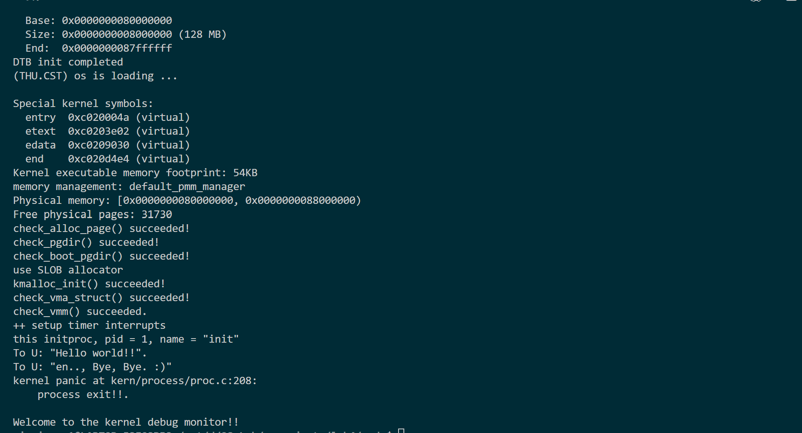
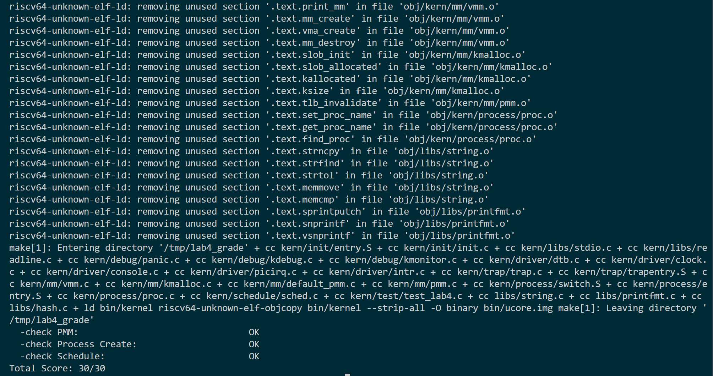

# 操作系统实验报告

## 实验基本信息

| 项目 | 内容 |
|------|------|
| 实验名称 | Lab 4：虚拟内存页操作与内核线程管理 |
| 小组成员 | 2413646-秦紫轩、2412933-李易桐、2413524-洪若曦 |
| 完成日期 | 2026-11-20 |

### 小组分工

| 成员 | 任务 |
|------|--------------------|
| 2413646-秦紫轩 | 模块一、测试、整合报告。 |
| 2413524-洪若曦 | 模块二：进程创建与初始化，衔接 Lab2 依赖，创建失败与资源清理测试， PCB 与 PID 分配分析 |
| 2412933-李易桐 | 模块三：完成调度与切换，以及衔接 Lab3 适配。 |

---

## 一、实验目的

1. 了解虚拟内存管理的基本结构，掌握虚拟内存的组织与管理方式
2. 了解内核线程创建/执行的管理过程
3. 了解内核线程的切换和基本调度过程

---

## 二、实验环境

### 2.1 构建与运行环境

| 项目 | 配置 |
|------|------------------|
| Linux 环境 | WSL2，`os` 发行版，Ubuntu 20.04.3 LTS |
| 目标平台 | QEMU `virt`，RV64，Sv39 |
| 交叉编译器 | `riscv64-unknown-elf-gcc` 10.2.0，SiFive GCC-Metal 10.2.0-2020.12.8 |
| 模拟器与固件 | QEMU 4.1.1，OpenSBI v0.4 |
| 其他工具 | GNU Make 4.2.1、Python 3.8.10、SiFive GDB 10.1、`bc` |


### 2.2 AI 工具

| 成员 | AI 编程工具 | 底层模型 | 用途 |
|------|------------|----------|----------|
| 2413646-秦紫轩 | ChatGPT（VS Code 插件） | ChatGPT 6.1 Sol | 页操作。 |
| 2413524-洪若曦 | ChatGPT（VS Code 插件） | ChatGPT 6.1 Sol | 进程创建与初始化。 |
| 2412933-李易桐 | ChatGPT（VS Code 插件） | ChatGPT 6.1 Sol | 进程调度、切换。 |

---

## 三、实验整体逻辑分析

### 3.1 逻辑主线

本实验按“地址映射准备 → 线程创建 → 调度运行”展开。页操作保证内存映射可维护，创建模块装配线程资源，调度模块选择线程并恢复其执行现场。

```text
kern_init()
    ↓
pmm_init()：物理页管理 → 页表与启动映射检查 → kmalloc 初始化
    ↓                   依赖 page_insert / page_remove【C】
pic_init() → idt_init() → vmm_init()
    ↓
proc_init()【A】：包装 idleproc，创建 initproc
    ↓
clock_init() → intr_enable() → cpu_idle()【B】
    ↓ need_resched
schedule() 选择可运行线程 → proc_run() 切换 current、satp、TLB
    ↓
switch_to() 保存旧 context、恢复新 context
    ↓ initproc 首次执行
forkret → forkrets → __trapret → RESTORE_ALL → sret
    ↓
kernel_thread_entry → init_main() → 输出线程信息
```

### 3.2 功能的逐步实现

首先沿用已合入的物理页管理和 Trap 依赖，补齐页映射接口。随后由 A 创建线程并准备首次运行现场，B 完成调度选择和上下文切换。

---

## 四、实验内容与实现

### 4.1 虚拟内存页操作

负责人：2413646-秦紫轩。

#### 模块功能描述

本模块建立、更新和撤销虚拟页到物理页的映射，保持页表项、物理页引用计数和 TLB 状态一致，提供以下接口：

```c
int page_insert(pde_t *pgdir, struct Page *page, uintptr_t la, uint32_t perm);
void page_remove(pde_t *pgdir, uintptr_t la);
```

`page_insert()` 通过 `get_pte(pgdir, la, 1)` 获取末级 PTE，再增加新页引用。同页重映射时抵消本次增加，仅更新权限，避免误释放自身；替换其他页时撤销旧引用，归零才释放。随后写入目标页、调用者指定权限及有效位，失效对应 TLB，成功返回 0。

页表分配失败时返回 `-E_NO_MEM`。若 `get_pte()` 已新建部分中间表，则恢复原根表项并回收本次新建空表，保持旧映射、相关引用和空闲页数不变，不留下半完成映射。

`page_remove()` 使用 `create=0` 查找，无表或无有效映射时正常返回，不分配页表。有映射时通过静态辅助函数清除 PTE、失效 TLB、减少引用，归零才释放物理页；重复删除不重复减引用或释放，因此满足幂等性。普通删除不自动回收空中间页表。

TLB 同步沿用按地址执行的 `sfence.vma`，并在 `tlb_invalidate()` 中补充 `"memory"` clobber，约束编译器重排，确保页表写入位于失效操作之前。

#### 提示词

完整实现 Prompt 见 [prompt_C.md](./prompt/prompt_C.md)，核心约定如下：

```text
[PROMPT]
补全 pmm.c 的 page_insert、page_remove，可添加静态删除辅助函数。
[RELY]
使用框架的 get_pte、PTE 构造、引用计数、释放和 TLB 接口。
[GUARANTEE]
保持页表项、引用计数与 TLB 一致，保留接口及 A/B 代码。
[SPECIFICATION]
插入成功返回 0，映射到目标页并按 perm 设置权限；同页更新不增净引用。
失败返回 -E_NO_MEM，回收本次新建空表，保持原状态，不留半完成映射。
删除必须幂等；无映射时正常返回，引用归零才释放，更新后失效 TLB。
```

### 4.2 进程创建与初始化

负责人：2413524-洪若曦。主要修改文件：`kern/process/proc.c`（标注 `LAB4 function2` 的位置）。完整提示词见 [prompt_A.md](./prompt/prompt_A.md)，完整个人报告见 [report_A.md](./prompt/report_A.md)。

#### 4.2.1 模块逻辑：两条创建线

本模块解决“线程从哪里来、如何进入系统、如何第一次运行”，处在整体链路的 `proc_init` 段，并为后续 B 版块调度准备结构完整、可被选中的进程对象。内部按两条线理解：

1. **idleproc 线（pid=0）**：系统启动后当前这条执行流本身就是一个可运行内核线程，不需要“复制”产生，而是直接分配 PCB、复用启动栈，包装成第 0 个线程；
2. **initproc 线（pid=1）**：启动初期没有父进程可复制，由 `kernel_thread` 手工构造中断帧，再经 `do_fork` 变成第一个真正的内核线程，首次执行目标是 `init_main`。

`proc_init` 结束时系统至少存在 `idleproc`（pid=0）与 `initproc`（pid=1），且 `current` 指向 `idleproc`。

#### 4.2.2 六个核心函数的理解

交付 6 个函数，职责一览：

| 函数 | 职责 |
|---|---|
| `alloc_proc` | 分配并清零 PCB，把各字段置于安全空白态 |
| `proc_init` | 初始化链表/哈希，包装 idleproc，创建 initproc |
| `kernel_thread` | 把函数入口+参数包装成首次运行所需中断帧 |
| `do_fork` | 装配 PCB/内核栈/地址空间/现场，登记并唤醒 |
| `copy_thread` | 在新栈顶安放中断帧、设置首次切换 context |
| `copy_mm` | 内核线程地址空间占位，置 mm=NULL |

逐个实现要点：

- **alloc_proc**：`kmalloc` 后先 `memset` 整体清零，再显式置 `state=PROC_UNINIT`、`pid=-1`、各指针字段为空、`pgdir=boot_pgdir_pa`、两个链表节点 `list_init`。意义是杜绝未初始化字段被后续代码误用，干净确定的初始态是后续装配的安全基础；分配失败返回 NULL，无副作用。
- **proc_init**：先初始化 `proc_list` 和每个哈希桶；`alloc_proc` 得到 idleproc，它不经过 fork，直接复用当前现场——`pid=0`、`PROC_RUNNABLE`、`kstack=bootstack`、`need_resched=1`，并令 `current` 指向它；再用 `kernel_thread(init_main, "Hello world!!", 0)` 创建 initproc，经 `find_proc` 取回并命名 “init”。关键对象分配失败直接 `panic`，不留半初始化子系统。
- **kernel_thread**：在局部中断帧 `tf` 上手工造出陷入现场，清零后 `s0=fn`（函数入口）、`s1=arg`（参数）；`status` 读 `sstatus` 后置 `SPP`（返回 S 态）、`SPIE`（sret 后开中断）并清 `SIE`；`epc=kernel_thread_entry`；最后调 `do_fork(clone_flags | CLONE_VM, 0, &tf)`。
- **do_fork**：按固定顺序 `alloc_proc → setup_kstack → copy_mm → copy_thread`，再在关中断临界区完成 `get_pid`、挂哈希表与进程链表、`nr_process++`，最后 `wakeup_proc` 并返回 pid。关中断是为防止链表修改与遍历链表的时钟中断并发；失败时通过 goto 阶梯按资源获取逆序清理。
- **copy_thread**：`proc->tf = (struct trapframe *)(proc->kstack + KSTACKSIZE) - 1`，C 指针减 1 自动减去 `sizeof(trapframe)=288`，无需手算；复制中断帧，`a0=0`（子进程 fork 返回 0）、`gpr.sp=kstack+KSTACKSIZE`，并设 `context.sp=tf`、`context.ra=forkret`，使首次 switch_to 后经 `forkret → forkrets → __trapret` 恢复。
- **copy_mm**：本阶段所有线程都是内核线程，`current->mm` 本就为 NULL，故仅 `assert(current->mm == NULL)` 确认前提，置 `proc->mm=NULL` 后返回；保留完整接口形态，方便后续实验扩展真正的地址空间复制。

#### 4.2.3 三项配套任务

**（1）衔接 Lab2 依赖。** A 建立在 Lab2 物理内存管理之上：`setup_kstack` 调 `alloc_pages` 分配内核栈、`page2kva` 取内核虚拟地址；清理路径 `put_kstack` 调 `kva2page` 与 `free_pages` 回收；新线程 `pgdir` 复用 `boot_pgdir_pa`。接口名、参数、返回值与工程真实定义一致。

**（2）创建失败与资源清理测试。** goto 阶梯保证“占用了多少资源，失败时就释放多少”，清理路径与失败点对应如下：

| 失败发生在 | 跳转标签 | 清理动作 |
|---|---|---|
| `alloc_proc` 失败 | `fork_out` | 尚未占用资源，返回 `-E_NO_MEM` |
| `setup_kstack` 失败 | `bad_fork_cleanup_proc` | `kfree` 释放 PCB |
| `copy_mm` 失败 | `bad_fork_cleanup_kstack` | 先 `put_kstack` 释放内核栈，再 `kfree` 释放 PCB |

标签采用“穿透”写法：`bad_fork_cleanup_kstack` 执行完自然落入 `bad_fork_cleanup_proc`，保证每个失败点都按资源获取逆序完整释放，不产生内存泄漏或残留链表结构。

**（3）PCB 与 PID 分配分析。**
- **PCB 字段分类**：身份与生命周期（`state/pid/runs/flags/name`）、执行资源（`kstack/context/tf/pgdir`）、关系与调度（`parent/need_resched/mm`）、链表挂接点（`list_link` 挂全局进程链表、`hash_link` 挂 pid 哈希表）。`alloc_proc` 负责初始化到安全空白态，`do_fork` 再逐步填成可运行实体。
- **get_pid 机制**：维护 `last_pid`（上一次分配值）与 `next_safe`（已存在 pid 中大于当前值的最小占用值）。分配时 `last_pid` 递增，只要仍小于 `next_safe` 就保证不与现有进程冲突；一旦达到 `next_safe`，重新扫描整个进程链表找出新的安全区间并跳过被占用的号。这种“惰性检查 + 冲突时重扫”既保证 pid 唯一，又避免每次分配都完整遍历链表。

#### 4.2.4 spec 与 prompt 是怎么写的

按 lab0.5 规范把需求规格（spec）与提示词（prompt）分开处理：

- **spec（行为规格）**：只描述每个函数“需要满足什么行为”，而非“具体怎么实现”，统一使用 `Pre-Condition / Post-Condition / Case / Requirements` 字段，覆盖正常路径与资源不足分支。
- **prompt（四段式，完整内容见 prompt_A.md）**：
  - `[PROMPT]`：明确只改 `proc.c` 的 `LAB4 function2`，必须修改真实文件、不碰 B/C 留空区域；
  - `[RELY]`：只放与本任务直接相关、且从工程真实代码核对过的宏、数据结构和可调用函数，遵循“最小、可信”原则；
  - `[GUARANTEE]`：列出 6 个必须实现的函数签名作为交付清单；
  - `[SPECIFICATION]`：逐函数给出行为规格。

提示词粒度为“一个能独立完成一项功能的模块用一个提示词”，因此 6 个函数合在一份提示词里，而非一函数一份。主要约定精简如下：

```text
[PROMPT]
补全进程创建与初始化模块，保留 B/C 代码及现有接口。
[RELY]
使用 proc_struct、context、trapframe、页分配、PID 和链表管理接口。
[GUARANTEE]
实现 alloc_proc、proc_init、kernel_thread、do_fork、copy_thread、copy_mm。
[SPECIFICATION]
初始化 PCB，装配内核栈和首次执行现场，登记 PID 后唤醒线程。
保证 sret 后栈有效；创建失败时按逆序释放已获取资源。
```

### 4.3 调度与上下文切换

负责人：2412933-李易桐。

#### 模块功能描述

`cpu_idle()` 观察 `need_resched`；`schedule()` 在关中断后沿进程链表选择可运行线程，没有候选者时选 idle。`proc_run()` 更新 `current`、写入目标页表对应的 Sv39 `satp`、刷新 TLB，再调用 `switch_to()`。旧线程再次被恢复时，从自己的调用位置继续完成中断状态恢复。

`switch_to()` 只保存、恢复 `ra`、`sp` 和 `s0`～`s11` 共 14 项 context，不负责选择线程或恢复完整 Trap frame。正式线程还需经过 A 准备的首次运行链路，才能进入目标函数。

#### 最终提示词

```text
[PROMPT]
实现 cpu_idle、schedule、proc_run 和 switch_to，保留 A/C 接口及实现。
[RELY]
使用进程链表、PROC_RUNNABLE、need_resched、context 和中断开关接口。
[GUARANTEE]
正确选择线程、切换 Sv39 页表与寄存器现场，并恢复原中断状态。
[SPECIFICATION]
跳过不可运行线程，无候选者时选择 idle；相同线程无需切换。
按 context 布局保存恢复 14 项寄存器，使用物理页表地址构造 satp。
```

### 4.4 spec 与 Prompt 的编写思路

主要就是注意约束现场布局、状态修改和返回位置，并为各项约定指定验证方法。spec 先规定前置条件、可观察结果和不变约定，再写实现提示词。
虚拟页操作以有效页目录和物理页为前提，约束同页更新、替换、空删除及分配失败的资源状态；进程创建与初始化约束线程资源与首次运行现场；调度与上下文切换约束线程选择规则与切换返回。各自都有对应的断言和运行检查。

Prompt 按 `[PROMPT]`、`[RELY]`、`[GUARANTEE]`、`[SPECIFICATION]` 组织，分别写任务位置、真实依赖、交付边界和行为要求。。

---

## 五、使用 AI 生成代码时遇到的 Bug 与解决

### 5.1 新线程恢复后 sp 为零

**遇到的问题：**

- A 阶段线程切换已进入 `forkret`，但 `sret` 后 `sp=0`，进入 `init_main` 使用栈时触发 store/AMO access fault（cause=7）。过程见 [A 阶段 Bug 分析](./prompt/report_A.md#六使用-ai-生成代码时遇到的-bug-与解决)。

**问题解决策略：**

- 对比切换前后栈指针，确认初始 trapframe 的 `gpr.sp` 经清零后未赋值，`RESTORE_ALL` 因而将 `sp` 恢复为零。
- 在 `copy_thread()` 中设置 `proc->tf->gpr.sp = proc->kstack + KSTACKSIZE`，使 Trap 返回后使用新线程的内核栈。

**最终结果：**

新线程能够进入 `init_main` 并输出预期信息，整合后的进程创建与调度测试均通过。

**关键改进点总结（如有）：**

`context.sp` 用于上下文切换，`tf->gpr.sp` 用于 Trap 返回，两处栈指针都必须正确设置。

### 5.2 框架测试回调与接口类型不一致

**遇到的问题：**

- 框架测试使用 `void (*)(void *)`，而 `kernel_thread()` 接收 `int (*)(void *)`。A 阶段记录为编译错误，本次整合时表现为不兼容指针告警。

**问题解决策略：**

- 保留正式接口，将测试回调返回类型改为 `int` 并补齐返回语句，不修改线程循环、断言和评分条件。

**最终结果：**

`make grade` 得到 30/30，构建无告警。

**关键改进点总结（如有）：**

测试代码也需遵守真实函数签名，不通过强制转换或放宽编译检查掩盖不匹配。

---

## 六、测试与验证

### 6.1 启动与页操作检查

编译通过后运行 `make qemu`，框架的物理页管理、页表、kmalloc 和 VMA 自检均通过。其中，`check_pgdir()` 和 `check_boot_pgdir()` 验证了映射建立与替换、引用计数、删除及共享映射的实际访存。随后 `initproc` 成功运行并输出预期信息。

注意到线程返回后出现的 `process exit!!.` 是框架 `do_exit()` 的占位行为，当前尚未实现完整退出与回收。



### 6.2 框架整体评分

运行框架自带的 `make grade`，PMM、进程创建和调度三项检查均通过。PMM 用例还检查了同页更新与重复删除，验证页操作与线程创建、调度能够衔接运行。



---

## 七、思考题与challenge

### 7.1 local_intr_save / local_intr_restore 如何控制中断

这两个名称是 [sync.h](../code/kern/sync/sync.h) 中的带参数宏，分别调用内联函数 `__intr_save()` 和 `__intr_restore()`，保存原中断使能状态并在临界区结束后恢复：

```c
static inline bool __intr_save(void) {
    if (read_csr(sstatus) & SSTATUS_SIE) {
        intr_disable();
        return 1;
    }
    return 0;
}

static inline void __intr_restore(bool flag) {
    if (flag) {
        intr_enable();
    }
}

#define local_intr_save(x) \
    do {                   \
        x = __intr_save(); \
    } while (0)
#define local_intr_restore(x) __intr_restore(x);
```

#### 保存并关闭中断

`__intr_save()` 读取 `sstatus`，用 `SSTATUS_SIE` 掩码检查 SIE 位。原来为 1 时，调用 `intr_disable()` 清零 SIE 并返回 1；原来为 0 时保持关闭并返回 0。保存的只是“原来是否允许 S 态中断”，不是整个寄存器。

`local_intr_save(intr_flag)` 将返回值赋给 `intr_flag`。`do { ... } while (0)` 只执行一次，用于把宏包装成一条语句，使其能安全用于 `if/else`；保存值由函数返回值决定。

#### 按原状态恢复

`local_intr_restore(intr_flag)` 将保存值传给 `__intr_restore()`：为 1 时调用 `intr_enable()` 置位 SIE，为 0 时不操作。这是恢复原状态，不是每次都开中断；临界区内部也应遵守不擅自开中断的约定。

`intr_enable()` 和 `intr_disable()` 的实际置位、清零操作定义在 [intr.c](../code/kern/driver/intr.c)。配对、逆序恢复时，嵌套调用也能保留最初状态：

```text
原 SIE=1 → 外层 save：flag=1，SIE=0
            → 内层 save：flag=0，SIE=0
            → 内层 restore(0)：保持关闭
          → 外层 restore(1)：重新开启
```

#### 配对使用与进程切换保护

```c
bool intr_flag;
local_intr_save(intr_flag);
/* 修改共享状态或执行切换操作 */
local_intr_restore(intr_flag);
```

在当前单 hart 实验中，这样可避免 S 态中断路径在共享状态更新中途重入。例如 `proc_run()` 保护 `current`、页表和 context 的切换；其中的 restore 在原线程再次恢复、从 `switch_to()` 返回后执行，新线程的中断状态由自身执行现场决定。

不过注意不阻止其他 hart，也不屏蔽同步异常，还不算多核互斥锁。

### 7.2 深入理解不同分页模式的工作原理

#### 分页层数与地址划分

| 模式 | 虚拟地址有效位数 | 页表层数 | 每级索引位数 | PTE 大小 | 每张表的条目数 |
|------|------------------|----------|--------------|----------|----------------|
| Sv32 | 32 | 2 | 10 | 4 字节 | 1024 |
| Sv39 | 39 | 3 | 9 | 8 字节 | 512 |
| Sv48 | 48 | 4 | 9 | 8 字节 | 512 |

三者基本页均为 4 KiB，页内偏移均为 12 位，每张页表也占 4 KiB。Sv39 的高位须扩展自 bit38，Sv48 扩展自 bit47；64 位寄存器不表示任意 64 位值都是合法虚拟地址。层数增加扩大了虚拟地址范围，也增加最坏情况下的行走层数与页表开销。

#### 为什么 get_pte 有两段相似代码

当前 [get_pte()](../code/kern/mm/pmm.c) 针对 Sv39，从 `PDX1` 定位根表项，再从 `PDX0` 定位下一层表项，最后用 `PTX` 定位末级 PTE：

```text
pgdir[PDX1(la)]
    → 若无表且允许创建：分配页、设置引用、清零、写入下级表地址
    ↓
下一级表[PDX0(la)]
    → 再完成同样的“检查并按需创建”
    ↓
末级表[PTX(la)]：返回这个 PTE 的地址
```

相似是因为多级页表每一层都使用“索引条目 → 取得下一级表”的相同结构。页目录已由调用者提供时，Sv32 只需保证一层下级表存在，Sv39 需要两层，Sv48 需要三层。可以用按层循环抽取共性，但索引宽度、PTE 大小和层数必须对应分页模式。


#### 查找与分配是否应拆开

调用者用 `create=0` 表示只查找，删除路径因此不会偷偷分配页。代价是同一接口可能修改页表、分配资源并失败，调用者还要理解部分创建的副作用。本次第二层分配失败后的清理，就是这种接口需要明确约定的地方。

我们认为当前规模可以保留该接口；若继续扩展，可对外区分只读的 `lookup_pte()` 和允许分配的 `ensure_pte()`，内部共用行走函数。创建接口应明确错误返回和失败回滚责任。

---

## 八、实验知识点

1. 程序与进程：源代码经过编译、链接形成可执行程序，程序是静态文件；启动后，操作系统为其建立执行环境、分配资源，形成进程。进程是动态实体，包含代码、数据、地址空间和运行状态，并非只有正在占用 CPU 时才是进程，就绪或阻塞时也仍然存在。
2. 进程与线程：进程侧重资源管理，线程是其中的执行流。一个进程可以包含一个或多个线程；同一进程的线程共享代码、数据、堆等资源，各自保留栈和寄存器等执行状态。在支持线程的操作系统中，线程通常是基本调度单位。本实验调度的是共享内核地址空间的内核线程，尚未建立完整的用户进程资源隔离。
3. 物理页分配与虚拟页映射：`alloc_pages/free_pages` 管理物理内存的占用，`page_insert/remove` 管理虚拟地址到物理页的映射。分配物理页不等于已经建立映射。
4. 引用计数与共享：多个虚拟地址可以映射同一物理页，只有相关引用归零才回收。该机制支持共享与安全释放，但不等于已经实现写时复制。
5. 线程创建与调度：创建模块准备可运行线程，调度模块选择并恢复它。创建不等于立即执行，`PROC_RUNNABLE` 表示可运行，实际运行者由 `current` 指示。
6.  临界区与失败回滚：保存中断状态可防止本地中断路径中途重入，失败时回收新页表可避免资源泄漏。两者分别处理并发干扰和操作无法完成的问题。

---

## 九、重要但本实验尚未涉及的 OS 知识

1. 地址空间复制与按需分页：`copy_mm()` 未实现独立地址空间复制，也未完成写时复制、缺页恢复和页面置换；VMA 自检不能代替这些机制。
2. 进程退出与等待回收：`do_exit()` 仍为 panic 占位，未完成僵尸进程处理、`wait` 和资源回收。
3. 时间片抢占与优先级调度：时钟中断只计数，当前没有完整的时间片抢占及优先级策略。
4. 多核同步与 TLB shootdown：关闭本 hart 中断、执行本地 `sfence.vma`，不能保证其他 hart 的互斥访问或 TLB 同步。
5. 文件系统与设备 I/O：尚未实现文件读写、持久化及完整的设备请求处理流程。

---

## 十、实验总结与收获

### 10.1 理解

主要涉及到页表项、物理页引用计数和 TLB 状态需要一致；线程创建时准备的内核栈、context 和 trapframe，也必须与上下文切换及 Trap 返回的恢复约定一致，才能正确进入线程并在切换后继续执行。

### 10.2 AI 使用经验

AI 协作时，先从源码明确 spec，再把依赖、修改范围和验证要求写进 Prompt。

### 10.3 实验完成情况

已完成虚拟页映射与删除，整合进程创建、初始化、调度与上下文切换。普通启动通过页表等自检并输出 initproc 的预期信息，框架整体评分为 30/30。