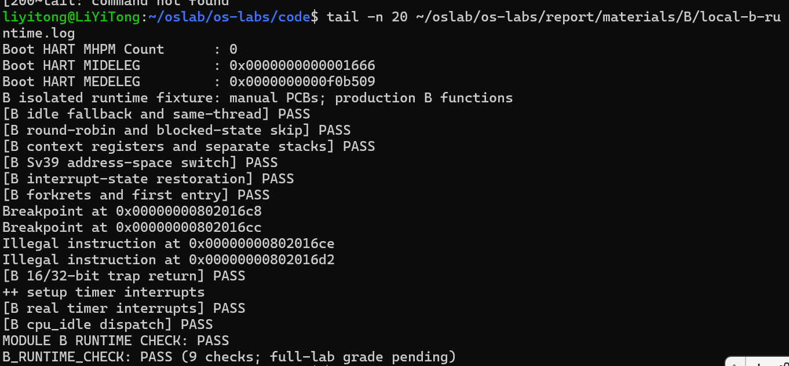

# Lab4 B 阶段记录

负责成员：李易桐，2412933。

## 实现范围

- cpu_idle：检查重调度标志，在需要时调用调度器。
- schedule：关中断后清除当前重调度标志，从当前位置之后遍历可运行线程；无合适线程时选择 idle，增加运行次数后调用 proc_run。
- proc_run：保存中断状态，更新 current，使用物理页目录地址组成 Sv39 satp，刷新 TLB，再调用 switch_to；原线程恢复执行后恢复自己的中断状态。
- switch_to：按 context 布局保存与恢复 ra、sp、s0～s11，共 14 个寄存器。
- Lab3 依赖：迁移已有 RESTORE_ALL 与 Trap 参数传递，保留 Lab4 的 SAVE_ALL、forkrets 和内核访问用户映射设置；补齐本阶段所需中断、异常处理。

## 依赖适配

导入的 Lab3 只有 A 阶段成果，两个中断、异常处理函数仍留空。本阶段新增适配逻辑，不把它记为已经完成的旧实验成果。时钟中断设置下一次事件并累计 ticks；软件中断清除挂起位；断点和非法指令按 16/32 位编码推进 epc。其他内核异常输出现场并停机诊断。

## 中断开关 Challenge

local_intr_save 读取 sstatus.SIE，原来开启时才关闭并返回真；local_intr_restore 仅在保存值为真时重新开启。嵌套临界区中，内层保存到关闭状态，退出时不会提前开中断。此机制针对本实验的单核中断交错，不等于多核互斥锁。

## 验证状态

- 本机编译器：riscv64-unknown-elf-gcc 15.1.0。
- 本机模拟器：QEMU 7.0.0；固件：OpenSBI v1.0。
- B 修改的五个文件独立编译通过。
- 独立 QEMU 运行九项通过，当前源码与运行日志中的哈希一致。
- 准备阶段另有 15474 种主机模拟状态检查，与本机运行结果分别记录。

[编译日志](local-b-compile.log)；[运行日志](local-b-runtime.log)。

本专项使用手工构造的 PCB、页表和内核栈，直接运行 B 源码。正式 A/C 接口、整组启动及官方评分尚待合并验证。

## 交接

A 完成 LAB4 function2 及 Lab2 留空区域；C 完成 LAB4 function1。proc.c 按函数合并，保留 cpu_idle 和 proc_run。后续按实际结果追加测试、Bug 修复、日志、截图和提示词。

## B 的 spec 与原理补充

整体逻辑为 proc_init → cpu_idle → schedule → proc_run → switch_to。正式新线程还需由创建模块构造初始 context 和 trapframe，再经 forkret、forkrets、__trapret、kernel_thread_entry 执行目标函数。本专项以夹具连接真实 forkrets 和恢复代码，没有验证正式创建接口及完整 forkret 链路。

### 四个函数的 spec

- cpu_idle：前提是 current 指向有效的 idle PCB；持续观察 need_resched，需要时调用 schedule，空闲循环不返回。
- schedule：前提是 current、idleproc、进程链表均已初始化；保存并关闭中断，清除当前重调度标志，从当前位置之后环绕选择可运行线程，无合适线程时选 idle；增加目标 runs 并调用 proc_run，原执行流恢复后恢复原中断状态。
- proc_run：目标 PCB 非空、可运行，pgdir 是页表物理地址，context 有效；相同目标时跳过切换，否则保护临界区，更新 current，设置 Sv39 satp、刷新 TLB并调用 switch_to；旧线程恢复后继续完成中断状态恢复。
- switch_to：from/to 指向有效 context，目标 ra/sp 已准备；保存和恢复 ra、sp、s0～s11 共14项，旧线程再次恢复时从调用后继续；不负责选择线程、切换页表或保存 trapframe。

### 原理联系和范围

schedule 负责选择目标，proc_run 组织切换，switch_to 搬移寄存器现场。context 保存 ra/sp 和12个 callee-saved 寄存器；调用者按 ABI 负责跨函数调用仍需保留的 caller-saved 值。trapframe 保存 Trap 返回所需的更完整现场。

runs 是调度次数，不是CPU时间。PROC_RUNNABLE 同时涵盖就绪与运行，current 指示实际运行者。当前按链表位置选择下一可运行者；时钟处理没有触发时间片抢占。

多核调度与锁、优先级调度、完整阻塞唤醒、用户进程资源隔离及退出回收尚未完整体现。专项测试中的不同页表是夹具，用于验证切换机制。

### spec、提示词和实际问题

spec 根据指南、真实接口、结构布局和既有辅助函数整理，重点约束中断状态恢复、Sv39编码及修改范围。实际任务请求与反馈单独记录在 prompt-B.md。

首次安装因下载目录缺少老师的压缩包而停止，放入后安装成功。后续长段命令粘贴卡住，重新进入 lab4 分支并改成短命令收尾，已有代码和测试结果保留。这些属于文件准备及操作问题；本机 B 代码首次编译五项通过，首次独立 QEMU 九项通过，暂未观察到生产代码的编译或运行失败。

正式 A/C 模块合入后，B 仍需完成最终合并检查、整组评分及全员实际提示词汇总。
