# Lab2 实验报告：物理内存、连续页分配与页表查询

## 一、基本信息与分工

| 姓名 | 学号 | 负责内容 |
|---|---|---|
| 李易桐 | 2412933 | 功能模块一：物理内存探测与 `page_init()`；GDB 调试及报告整合 |
| 洪若曦 | 2413524 | 功能模块二任务一、二：First-Fit 分析与 Best-Fit 实现，代码测试 |
| 秦紫轩 | 2413646 | 功能模块二任务三：Buddy System 实现、接入与专项测试 |

整理日期：2026 年 10 月 21 日。三位成员的 AI 工具与模型按成员提供的信息统一记录为 **ChatGPT / 6.1 Sol**。

**本版状态：** 实现分析、Prompt、已有测试日志和 GDB 证据已整合。本次整合修复了 Best-Fit 两处尾插循环终止问题，并统一了 Makefile 的内核加载参数；四项宿主回归通过，李易桐应用整合版后在 WSL 重新评分，两项检查均为 `OK`，总分为 `20/20`。新旧评分的真实终端文字分别保留，整合版评分原图及三张队友测试原图均已归档并配有图注。本终稿的内核源码与此次 WSL 20/20 复评分版本一致。

## 二、实验目的与环境

本实验建立从硬件 RAM 信息到可分配物理页的管理过程，理解 `Page` 描述符与空闲块链表，比较 First-Fit、Best-Fit 与 Buddy 的分配、拆分和合并方式，并通过调试 QEMU 观察 Sv39 地址翻译与软件 TLB 填充。

李易桐本次评分与 GDB 调试使用的环境如下；Buddy 附带日志来自队友的运行环境，日志中的 OpenSBI 版本及内核符号位置可以不同。

| 项目 | 已记录版本或配置 |
|---|---|
| 系统 | WSL2，Ubuntu 22.04.5 LTS，x86-64 宿主 |
| 编译器 | `riscv64-unknown-elf-gcc` 15.1.0 |
| QEMU | 7.0.0；`/opt/qemu/bin/qemu-system-riscv64`，带调试信息 |
| 宿主 GDB | GNU GDB 12.1，用来调试 QEMU 本身 |
| Make / Python | GNU Make 4.3 / Python 3.10.12 |
| 模拟平台 | RISC-V `virt`，本次 RAM 为 128 MiB |
| 物理内存范围 | `[0x80000000, 0x88000000)`，右端为开区间 |
| 内核物理加载地址 | `0x80200000` |
| 内核虚拟加载地址 | `0xffffffffc0200000` |
| 虚实偏移 | `PHYSICAL_MEMORY_OFFSET = 0xffffffff40000000` |

正常构建默认使用 Best-Fit；`PMM=buddy` 才选择 Buddy。`PMM` 的默认变量值虽然名为 `default`，其非 Buddy 分支在 `pmm.c` 中实际选择的是 `best_fit_pmm_manager`。

## 三、功能模块一：物理内存探测与初始化

### 3.1 初始化链路与核心对象

`kern_init()` 先调用 `dtb_init()` 解析设备树，再进入 `pmm_init()`。后者选择并初始化分配器，调用 `page_init()` 登记可用物理页，执行分配器检查，最后记录启动页表的虚拟地址和物理地址。

| 对象 | 含义与使用方式 |
|---|---|
| 虚拟地址 VA | 内核指针使用的地址；`end` 和 `pages` 都属于这一类 |
| 物理地址 PA | RAM 中的实际地址；内核直接映射范围通过 `PADDR()` 换算 |
| 物理页号 PPN | 物理地址右移 `PGSHIFT`，不是 `Page` 数组下标 |
| `pages` | 描述物理页的 `struct Page` 数组起点 |
| `nbase` | `DRAM_BASE / PGSIZE`，数组对应的第一个物理页号 |
| `npage` | 可管理内存上界对应的物理页号，数组元素数为 `npage - nbase` |

本实现检查设备树 RAM 起点等于教学平台的 `DRAM_BASE`，拒绝零容量及加法溢出，并用 `PHYSICAL_MEMORY_END` 限制可管理上界。因此它针对本工程的单段直接映射 RAM，不是适配所有硬件内存布局的通用探测器。

### 3.2 地址与边界计算

关键计算对应 `code/kern/mm/pmm.c`：

```c
mem_end = min(mem_base + mem_size, PHYSICAL_MEMORY_END);
va_pa_offset = PHYSICAL_MEMORY_OFFSET;
npage = PPN(mem_end);
page_count = npage - nbase;
pages = (struct Page *)ROUNDUP((uintptr_t)end, PGSIZE);
pages_pa = PADDR(pages);
free_end = ROUNDDOWN(mem_end, PGSIZE);
free_start = ROUNDUP(pages_pa + page_count * sizeof(struct Page), PGSIZE);
```

这里的 `min` 是说明计算含义的记法，实际源码用条件分支限制上界。128 MiB 配置下，`nbase = 0x80000`、`npage = 0x88000`，因此需要 `0x8000` 个页描述符，而不是 `0x88000` 个。

描述符数组从内核结束后的页边界开始。代码先检查其完整空间能否容纳，再初始化数组，避免先写描述符、后发现已经越过 RAM 上界。空闲区起点向上对齐，末端向下对齐，只登记完整页；可用空间不足时通过 `panic` 终止。

### 3.3 保留区与可分配区

所有描述符先清除残留状态，设置引用计数为 0、初始化链表节点并标记为保留；之后只将 `[free_start, free_end)` 交给当前分配器的 `init_memmap()`。这样 OpenSBI 所在的低端保留区、内核镜像、内核栈及描述符数组都不会进入空闲链表。

普通构建调用 `init_memmap()`；Buddy 专项测试构建调用 `buddy_test_init_memmap()`，后者用相同的真实空闲 RAM 分阶段登记测试区域，不是用虚构页面替代实际内存。

### 3.4 实现与验证过程

本模块先核对 `dtb.h`、`memlayout.h`、`pmm.h` 的真实接口，再补全 `page_init()`；编译后检查启动输出和分配器自检，随后执行评分并通过 GDB 核对启动映射。模块一原始成功截图如下，图中的 `default_pmm_manager` 对应使用 First-Fit 的早期独立验证，Best-Fit 的结果另见测试章节。不同构建的内核符号位置可以不同。

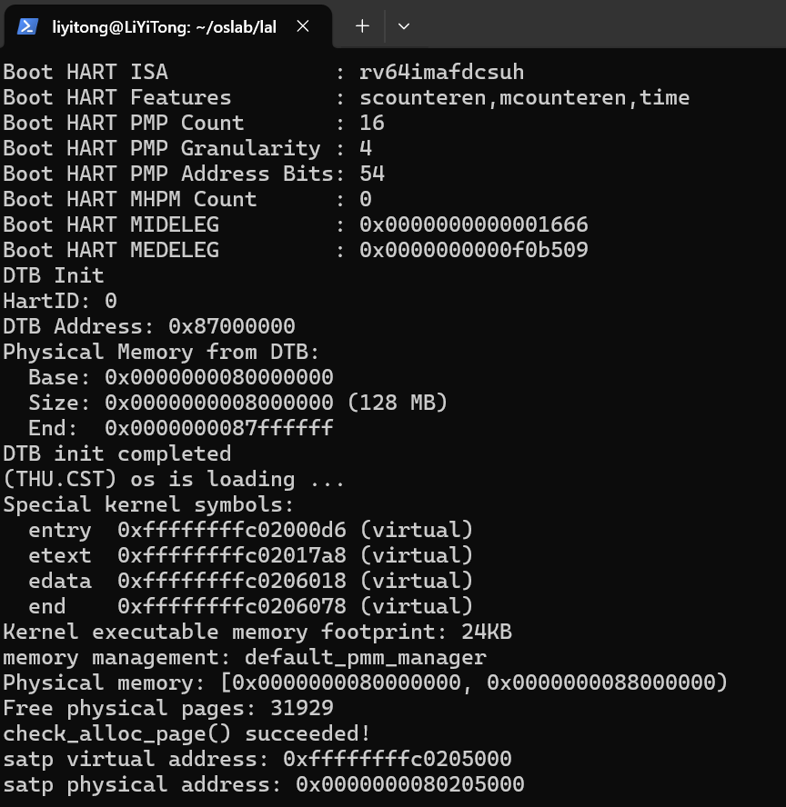

本模块采用的两条 Prompt 已完整放入 [prompt.md](prompt.md)，分别约束实现边界与验证过程；它们是对话中确认的整理版。整合时将 `//lab2 function1 YOUR CODE` 补为 `//lab2 function1 2412933`，保留了任务标记。

## 四、功能模块二：连续物理内存分配算法

### 4.1 任务一：First-Fit 的组织与执行过程

`default_pmm.c` 使用按地址升序排列的双向循环链表，每个节点挂在空闲块首页的 `page_link` 上。首页的 `property` 保存连续页数，`PG_property` 标明该页是空闲块首页；`nr_free` 是所有空闲页总数。

| 函数 | 作用 |
|---|---|
| `default_init()` | 初始化空链表，将空闲页计数置 0 |
| `default_init_memmap()` | 将一段保留页转为空闲块，设置首页信息并按地址插入 |
| `default_alloc_pages(n)` | 从链表头寻找第一个足够大的块，分配前 `n` 页，将剩余部分重新挂回 |
| `default_free_pages(base, n)` | 回收页、按地址插入，再与前驱和后继的相邻空闲块合并 |
| `default_nr_free_pages()` | 返回当前空闲总页数 |

与前驱合并时，前驱保留为新块头：前驱的 `property` 累加当前块大小，清除并摘下当前块头，随后再检查新块与后继的邻接关系。该过程不能简单表述为“把前驱删除”。

First-Fit 在第一个满足请求的块处结束查找，最坏仍需扫描整个链表。链表头部的小空闲块会增加后续查找成本；即使空闲页总量充足，也可能因不连续而无法满足大块申请。

### 4.2 任务二：Best-Fit 实现

Best-Fit 复用相同的管理器接口和按地址组织的空闲链表，核心差异是遍历所有候选块，在 `property >= n` 的块中选取最小者。

```c
if (p->property >= n) {
    if (page == NULL || p->property < page->property) {
        page = p;
    }
}
```

找到块后，分配流程摘下旧块，必要时将尾部剩余页作为新空闲块插回，扣减 `nr_free`，清除已分配块首页的空闲标记。释放流程按地址插入，再检查前后邻接关系。

原有 `best_fit_check()` 设置一个 2 页空闲块和一个 1 页空闲块，要求 1 页申请返回恰好 1 页的块。这能区分最小满足块选择与 First-Fit 的首次满足选择，但不能覆盖所有链表变更路径。

Best-Fit 以额外的全表扫描换取较紧凑的块选择，但并不保证没有外部碎片。较小残块仍能服务小请求；它们对大连续请求的限制来自大小和连续性，而不是“小于若干页就完全不可使用”。按大小索引或分桶可以改善查找；页内小对象可再由 SLAB/SLUB 一类分配器管理，本实验交付不包含 SLUB 实现。

#### 整合时发现并修复的尾插问题

本次实际上传源码中，`best_fit_init_memmap()` 和 `best_fit_free_pages()` 的尾插分支在插入 `base` 后没有退出循环。循环再次访问刚插入的节点，可能把该节点再次插入自身之后，使反向链接失效，进而妨碍相邻空闲块合并。

一个直接用例是先分配 4 页，再按地址顺序分别归还前两页。原实现报告空闲总页数为 2，但再次申请连续 2 页返回 `NULL`。修复是在两处尾插成功后增加 `break;`：

```c
} else if (list_next(le) == &free_list) {
    list_add(le, &(base->page_link));
    break;
}
```

没有修改原有 `basic_check()`、`best_fit_check()` 的函数体或断言。新回归直接编译实际 Best-Fit 源码及实际 `list.h`，只为宿主运行替代了内核框架依赖；其结果不能替代 RISC-V 启动验证。

| 回归用例 | 上传原版 | 修复版 |
|---|---|---|
| 两个相邻单页释放后申请连续 2 页 | 返回 `NULL` | 返回预期块，计数归零 |
| 多段登记后的链表双向链接和计数 | 链接损坏 | 通过 |
| 最小满足块选择、剩余计数及链表完整性 | 综合检查失败 | 通过 |
| 原有 `basic_check()` 与 `best_fit_check()` | 通过 | 通过 |

记录见 [修复前日志](materials/regression/before.log)、[修复后日志](materials/regression/after.log) 与 [回归脚本](materials/regression/check_best_fit.py)。复现命令从仓库根目录执行：

```bash
python3 report/materials/regression/check_best_fit.py --source code
```

Best-Fit 原始分报告和 Prompt 分别保存在 [原报告](materials/originals/best-fit/report.md) 与 [原 Prompt](materials/originals/best-fit/prompt.md)。任务标记已补为 `//lab2 function2-2 2413524`。

### 4.3 任务三：Buddy System

Buddy 在 `buddy_pmm.c/.h` 中通过按块大小分级的空闲链表管理物理页。块大小为 2 的幂；申请 `n` 页先向上取整到实际块大小，再寻找该阶或更高阶空闲块，逐级二分，将未分配的一半放回对应空闲链表。

实现采用块首页记录：`property` 保存实际块页数，`PG_property` 标记空闲首页，`flags` 中当前框架未使用的 bit 2 标记已分配首页；非首页不保存有效块身份，不额外维护每页 Buddy 状态数组，也不保存原请求数或长期存储阶数。

伙伴关系依据绝对物理页号计算：

```text
partner_pfn = page2ppn(base) ^ block_pages
```

仅当伙伴在合法范围内、已登记、空闲且块大小相同，才移除伙伴并合并到较低地址的父块。相邻但不符合伙伴关系的块不能合并。登记一段不规则起点、非 2 的幂页数的区域时，代码将其分解成符合物理页号对齐要求的多个块，并保持未登记间隙为保留状态。

释放接口要求传入实际已分配块的首页，并释放整个块。参数 `n` 的向上取整结果必须与首页记录的实际大小一致，因此同一 4 页块可按约定用 3 或 4 作为释放参数；这不表示支持部分释放。分配和释放过程不逐页重置内部页，调用者负责移除映射、消除引用，并停止使用整个块。

`PMM=buddy` 在构建时选择 Buddy。普通 Buddy 构建的 `.check` 为 `NULL`，内核明确输出 `PMM check skipped`；只有 `BUDDY_TEST=1` 才安装专项测试回调。不能把“跳过检查”当作“检查通过”。

实现经过分阶段 Prompt 推进：管理基础和分配、释放与合并、改为块首页管理、注册和构建接入，再设计与运行专项测试。完整原始记录收在 [实现 Prompt](materials/originals/buddy/buddy_prompt1.md) 和 [测试 Prompt](materials/originals/buddy/buddy_prompt2.md)，并汇入总 [prompt.md](prompt.md)。

## 五、测试结果与判定依据

### 5.1 测试证据总览

| 项目 | 已有结果 | 证据与状态 |
|---|---|---|
| 模块一初始化 | 初始化及所用分配器自检成功 | 本报告模块一原图 |
| 整合前 WSL `make grade` | 两项 `OK`，`Total Score: 20/20` | [会话终端文字转录](materials/grade-session-transcript.txt)，作为历史评分记录保留 |
| 整合后 Best-Fit 宿主回归 | `4/4 passed` | 修复前后日志、实际源码回归脚本 |
| 整合后 WSL `make grade` | 两项 `OK`，`Total Score: 20/20` | [本次终端文字转录](materials/grade-integrated-transcript.txt) 与下方评分原图；原始 `tee` 日志保存在用户仓库 |
| Best-Fit 历史自检 | `check_alloc_page() succeeded!` | 下方历史构建原图；整合版结果另由本次评分与宿主回归支撑 |
| Buddy 正常专项测试 | `ALL PASS (7 groups)` | 下方原图与 [normal.log](materials/buddy-tests/buddy_test_logs/normal.log) |
| Buddy 非法操作 | 15 个对应断言用例通过 | [完整队友结果](materials/buddy-tests/buddy_test_results.md) 与逐用例日志 |
| 普通 Buddy 镜像恢复 | 正常启动，明确跳过未安装的自检 | [ordinary.log](materials/buddy-tests/buddy_test_logs/ordinary.log) |
| QEMU 页表查询与 TLB 填充 | 已观察完整目标调用链与缓存项写入 | 第六节截图和完整 GDB 日志 |

评分图与三张队友原图均按原始字节保留。队友截图与文字日志可能来自不同构建或运行，内核符号位置有差异时应分别阅读各自现场；它们共同支撑对应测试结果，不要求所有图片和日志具有相同的宿主版本或符号偏移。

### 5.2 整合版评分与评分范围

李易桐在应用整合版后执行下列命令，重新完成编译、启动和评分；原图同时显示执行命令、两项 `OK` 与 `Total Score: 20/20`。

```bash
make grade QEMU=qemu-system-riscv64 2>&1 | tee ../report/materials/grade-final.log
```

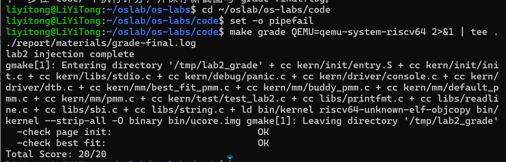

这张是修复 Best-Fit 尾插并统一启动参数后的新评分图，与此前保留的历史评分转录分开归档。终稿仅补充图文材料和同步辅助逻辑，内核源码未再修改。

评分在临时副本注入 `tools/test_lab2.c`，执行后检查两条标记，每条 10 分。`test_page_init()` 核对地址偏移、内存范围、描述符位置、空闲页数、内核和描述符保留状态以及地址转换往返；`test_best_fit()` 本身只检查管理器是否为 `best_fit_pmm_manager`。此前 `pmm_init()` 还会执行管理器原有自检。

因此 `20/20` 说明给定评分条件通过，不等于所有释放顺序、链接关系或边界场景均已覆盖。尾插回归的失败与原自检通过可以同时成立，增加独立行为用例能补足这项覆盖。

### 5.3 Best-Fit 历史自检原图

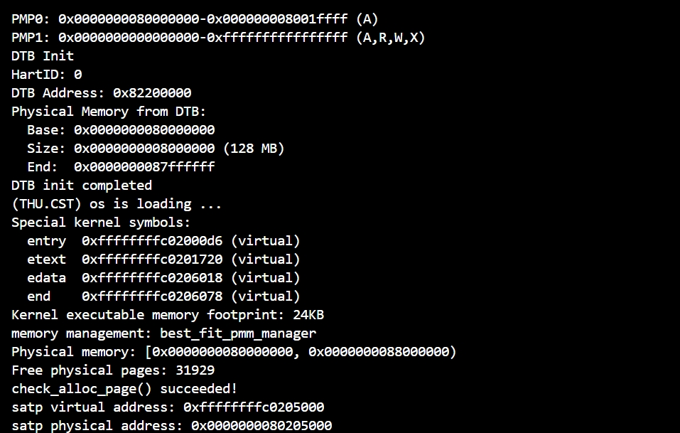

图中管理器为 `best_fit_pmm_manager`，识别 128 MiB RAM，显示空闲页 31929，并输出 `check_alloc_page() succeeded!`。这是队友原先构建的自检证据；第四节的独立回归补充了原自检未覆盖的尾插路径，修复后整合版本另以本次 `20/20` 评分确认。

### 5.4 Buddy 正常与负面用例

正常日志覆盖七组行为：页面分阶段登记、申请取整与对齐、真实物理页数据隔离和复用、超大请求失败不改变状态、耗尽与碎片恢复、伙伴级联合并及非伙伴拒绝合并、32 轮混合申请释放后恢复基线。用受控区域和资源耗尽限制其他空闲块参与，可以避免合并错误被另一块可分配内存掩盖。

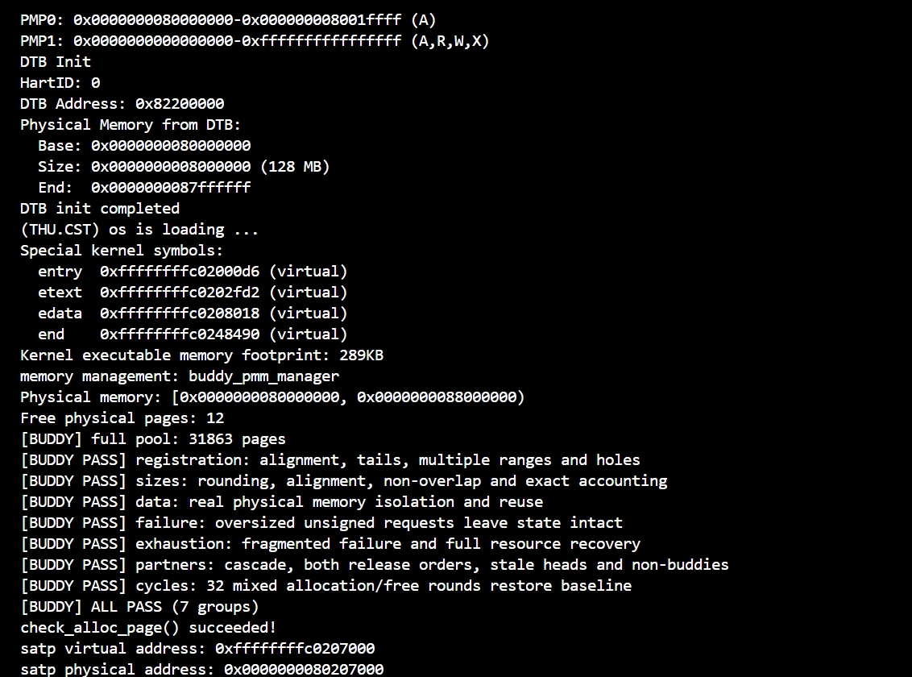

图中记录 `buddy_pmm_manager`、完整内存池 31863 页和七组通过标记。

正常测试最初输出的 `Free physical pages: 12` 是先登记的边界样本，随后补齐内存池并记录 `[BUDDY] full pool: 31863 pages`，不是内存探测只发现了 12 页。

15 个非法操作按用例分别启动，覆盖零页申请、空指针释放、重复释放、内部页释放、错误大小、描述符不对齐及上下界、保留页释放、零页和超大释放、块首页仍被引用、重复登记、零页登记和登记上界越界。每例要求用例号、分配器报错文件和具体断言匹配，超时或任意 panic 都不能单独视为通过。

例如 case=1 的真实日志同时包含：

```text
[BUDDY EXPECT PANIC] case=1
kernel panic at kern/mm/buddy_pmm.c:167:
    assertion failed: buddy_initialized && n > 0
```

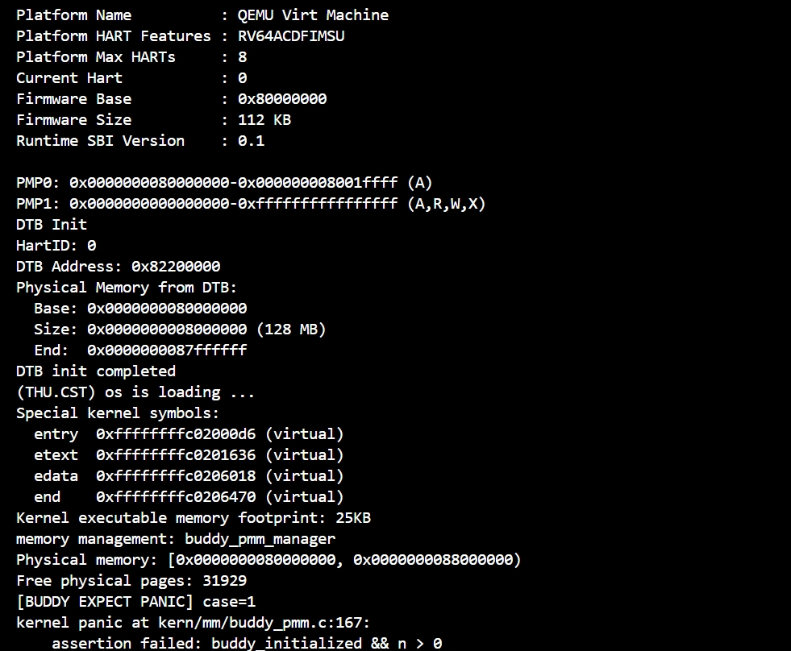

这说明零页申请被预期断言拒绝。普通镜像恢复记录用于确认测试开关关闭后仍可启动，不替代正常行为测试。以上结果不覆盖并发、所有内部页引用状态、映射建立与解除或任意越界写入防护。

## 六、GDB 调试 QEMU：页表查询与软件 TLB

### 6.1 调试对象与入口

本次使用宿主 GDB 调试 x86-64 的 QEMU 进程，在 QEMU 的 RISC-V 地址翻译代码中观察来宾内核地址，不是仅在来宾内核打印页表地址。调试命令使用 `-kernel bin/ucore.img`，控制台和 GDB 输出分别保存为 [qemu-console.log](materials/gdb-logs/qemu-console.log) 与 [qemu-gdb.log](materials/gdb-logs/qemu-gdb.log)。

初始条件断点限定 `riscv_cpu_tlb_fill()` 的地址位于 `kern_init` 所在页，实际停住的取指地址为 `0xffffffffc02000d6`，访问类型为 `MMU_INST_FETCH`。调用栈连接 `get_page_addr_code_hostp()`、`tlb_fill()` 与 RISC-V 翻译入口；随后进入 `get_physical_address()`，观察 `satp` 和根页表计算。

### 6.2 根页表定位

日志中的 `satp = 0x8000000000080205`，模式字段为 8，即 Sv39；根页表 PPN 为 `0x80205`，物理地址为 `0x80205000`。它与启动页表符号的虚实换算相符。

Sv39 的最高层索引从虚拟地址的 VPN[2] 提取；本次值为 `0x1ff`，每项 8 字节，所以：

```text
idx      = (0xffffffffc02000d6 >> 30) & 0x1ff = 0x1ff
pte_addr = 0x80205000 + 0x1ff * 8 = 0x80205ff8
```

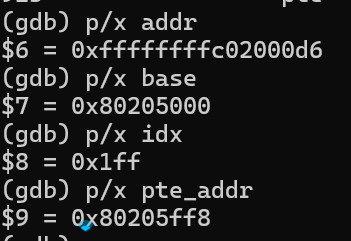

图中同时显示虚拟地址、根页表物理地址、索引和待读取 PTE 的物理地址，说明这些数值属于同一次查询。

### 6.3 页表项解码与物理地址

在 `cpu_helper.c` 读取 PTE 的语句执行后，观察到 `pte = 0x200000cf`、`res = 0`。低位权限与状态为 `V=R=W=X=A=D=1`、`U=G=0`，PPN 为 `pte >> 10 = 0x80000`。

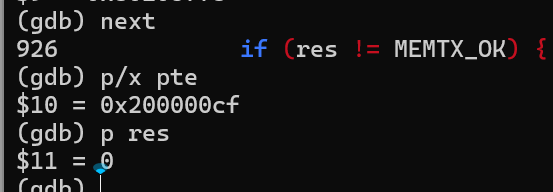

此项在根层已经是叶子，表示 1 GiB 大页映射；Sv39 支持三级查询并不意味着每次必须走满三级。本次用虚拟地址低 30 位作为大页内偏移：

```text
物理映射基址 = 0x80000 << 12 = 0x80000000
大页内偏移   = 0xffffffffc02000d6 & 0x3fffffff = 0x2000d6
最终物理地址 = 0x80000000 + 0x2000d6 = 0x802000d6
```

`finish` 返回 `riscv_cpu_tlb_fill()` 后，实际返回值为 0、`pa = 0x802000d6`、`prot = 7`，与计算一致。

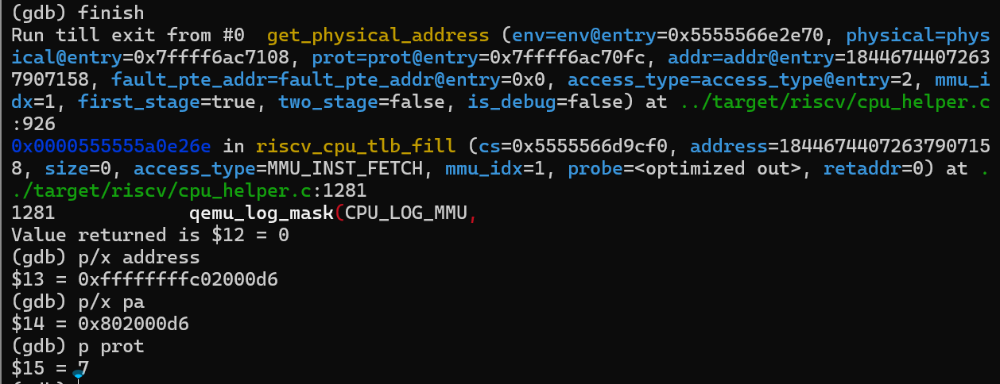

### 6.4 TLB 填充参数与调用链

经过 PMP 权限检查后，在 `cpu_helper.c:1304` 停住。代码将地址按 `tlb_size` 对齐后调用 `tlb_set_page()`；实际参数如下。

| 参数 | 本次实测值 |
|---|---|
| 原虚拟地址 | `0xffffffffc02000d6` |
| 原物理地址 | `0x802000d6` |
| 虚拟页起点 | `0xffffffffc0200000` |
| 物理页起点 | `0x80200000` |
| `prot` | `7`，读、写、执行 |
| `mmu_idx` | `1` |
| `tlb_size` | `0x1000`，4 KiB |

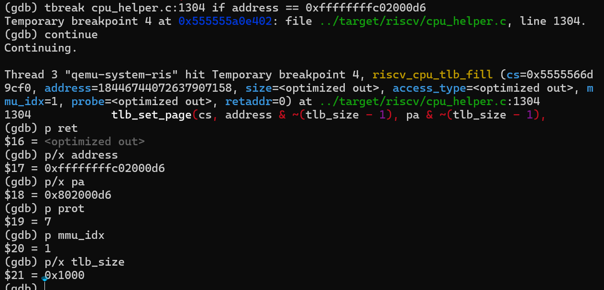

这里的 4 KiB 是本次 QEMU 软件 TLB 接口传入范围，不能把它写成页表已经改用 4 KiB 映射。页表根层叶子的 1 GiB 映射与软件实现本次填充的粒度属于不同层次。

单步进入 `tlb_set_page()` 后，调用栈与参数进一步确认该函数将工作转交给 `tlb_set_page_with_attrs()`。

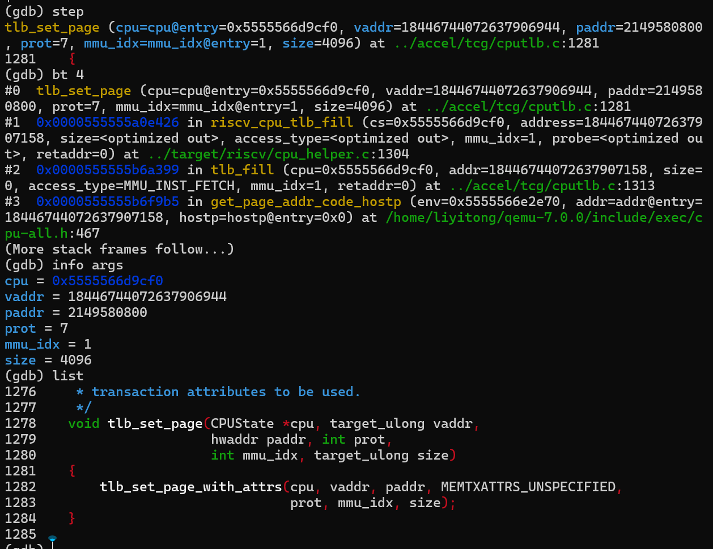

### 6.5 核对实际缓存项写入

`tlb_set_page_with_attrs()` 找到目标项 `te`，构造临时项 `tn`，在 `cputlb.c:1270` 调用 `copy_tlb_helper_locked(te, &tn)`。实际停在下一行时，分别读取 `tn` 和 `*te`，四个关键字段完全一致：

| 字段 | `tn` 与 `*te` 的相同值 |
|---|---|
| `addr_read` | `0xffffffffc0200000` |
| `addr_write` | `0xffffffffc0200400` |
| `addr_code` | `0xffffffffc0200000` |
| `addend` | `0x7fffeb200000` |

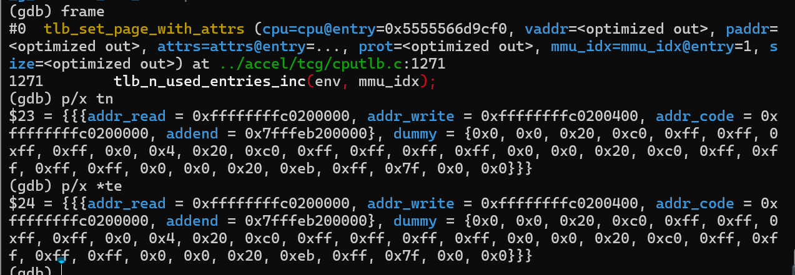

`addr_write` 的低位可包含软件 TLB 标志，不能把附加的低位直接当成虚拟页偏移。`addend` 根据宿主 RAM 指针与来宾虚拟页起点计算，用于软件快速访存；它不是来宾物理页基址，换一次 QEMU 进程也不要求宿主相关地址相同。

这组证据证明了本次目标取指的页表查询、权限处理和实际软件 TLB 项写入。理论上缓存命中可减少重复页表查询；本次没有另行统计命中率，也没有把“后续访问一定命中”或 TLB 失效实验作为已测结果。

### 6.6 调试遇到的问题及处理

| 现象 | 原因与处理 |
|---|---|
| 多行命令一次粘贴出现 `on or off expected` | 当前交互终端把多行合成一条；改为每次一条命令 |
| `until 825` 后读不到 `base`、`vm` | 优化后的行号路径未停在期望位置，函数已返回；改在实际 PTE 读取行设置断点并重新运行 |
| `ret` 显示 `<optimized out>` | 优化后没有可供 GDB 显示的位置；结合已命中的成功分支与其他实测参数判断，不把它当作数值 0 输出 |
| 在复制语句附近读不到 `te`、`tn` | 源码行断点落入内联函数上下文；通过 `bt`、`frame function tlb_set_page_with_attrs`、`info locals` 重新定位 |
| `p index` 显示 `strchr_ifunc` | 局部变量不在当前作用域时解析到同名库符号；该结果不能当作 TLB 槽索引 |

排错原图保存在 [内联帧排错截图](images/gdb-inline-frame-error.png)。恢复外层函数后，`te` 和 `tn` 可读取；正式结论采用上一节实际结构比较，而不是失败命令的输出。

## 七、环境问题与整合改动

### 7.1 QEMU 路径与加载方式

第一次评分尝试执行 `/opt/qemu`，该路径是目录而非可执行文件。用 `QEMU=qemu-system-riscv64` 在命令行明确覆盖后，解决了调用路径问题。

随后日志显示 OpenSBI 的 `Domain0 Next Address` 为 `0x0`，实验内核未正确接收控制权。把评分脚本加载参数改为 `-kernel bin/ucore.img` 后，入口变为 `0x80200000`，评分取得 `20/20`。没有删除评分标记或绕过分配器断言。评分成功后 Makefile 删除 `/tmp/lab2_grade`，因此随后再读取该目录日志出现文件不存在属于清理行为。

本次包保留已修好的 `grade.sh`，并把 Makefile 中 `qemu`、`debug`、`test` 三个目标的加载方式统一为 `-kernel $(UCOREIMG)`，使普通启动与评分启动保持一致。该启动适配不修改内核分配策略。

### 7.2 源码改动范围与验证边界

相对于此次上传材料，整合版源码只改了三个文件，具体见 [补丁](materials/integration-source-changes.patch)：

| 文件 | 本次改动 |
|---|---|
| `kern/mm/pmm.c` | 将模块一学号占位符替换为 `2412933` |
| `kern/mm/best_fit_pmm.c` | 替换学号为 `2413524`；两处尾插后退出循环 |
| `Makefile` | 三处启动加载参数统一为 `-kernel`，更新对应构建说明注释 |

Buddy 实现、Buddy 测试、评分脚本及其检查条件均与此次上传内容一致。原有 Best-Fit 自检函数体保持不变。宿主回归通过支持已测的数据结构行为；李易桐随后在上述 WSL 环境对整合版重新执行评分，交叉编译、QEMU 启动和两项评分检查均完成，总分为 `20/20`。该结论以其反馈的实际终端输出为依据。

## 八、Challenge：如何获取硬件可用物理内存范围

获取物理内存范围应依靠固件或硬件描述接口，而不能假设所有机器都固定有 128 MiB，也不宜靠对所有地址试写判断 RAM。对本实验的 RISC-V `virt` 平台，启动固件把设备树地址传给内核，内核由 `/memory` 或 `memory@...` 节点的 `reg` 属性取得 RAM 起点和长度；一般实现还需按父节点的 `#address-cells`、`#size-cells` 解释单元数，并转换设备树的大端数据格式。其他平台可使用对应固件提供的内存映射接口，例如 x86 的 BIOS E820 或 UEFI 内存映射。

“硬件报告的 RAM”与“当前能交给分配器的空闲页”必须分开。得到候选 RAM 后，还应排除固件保留区、内核和栈、页描述符、仍需保留的 DTB 数据及平台保留区；MMIO 不能混入普通 RAM。起点向上、末端向下按页对齐，并验证加法溢出、物理寻址能力和内核直接映射的上界。对于多段 RAM，应分别登记合法区间，保持空洞和保留区不可分配。

本工程通过 `get_memory_base()`、`get_memory_size()` 取得解析后的信息，再按 `DRAM_BASE` 起点和 `PHYSICAL_MEMORY_END` 上限实施管理。当前 `page_init()` 采用教学平台的单段 RAM 约定；若迁移到多内存银行、任意基址或额外保留洞的板卡，需要扩展区间表示、描述符布局和保留区处理，不能仅增加一个固定容量常量。这道题在本次按文字分析完成，不将 SLUB 的编程扩展列为已实现项目。

## 九、AI 使用、迭代与理解总结

### 9.1 使用方式与记录

模块一围绕真实接口、虚实地址区分、保留区、描述符空间检查和页对齐提出约束，再根据编译及启动日志迭代。模块二要求保留现有自检、选择最小满足块并维护按地址排序的空闲链表。Buddy 将管理状态、分配、释放、接入与测试拆为阶段，并进一步约束块首页管理和非法参数判定。

AI 参与了接口分析、代码补全、测试设计、故障定位和报告整理。实验人员提供材料、执行 WSL 命令、反馈真实输出并确认结果。本次整合另通过宿主回归发现尾插路径缺陷，再将两处最小修复和验证范围记录下来，没有把单次自检或评分当作所有边界均正确的证明。

模块一两条 Prompt 是经确认的整理版；Best-Fit 及 Buddy 原始材料逐项保留，Buddy 原文包含部分 AI 输出。新整理内容不冒充早期逐字对话。工具模型名称来自成员提供的信息，记录为 ChatGPT / 6.1 Sol；当前材料没有额外的界面版本截图。

### 9.2 与操作系统知识的对应

| 知识点 | 本实验中的对应 |
|---|---|
| 物理页管理 | 每个可管理页对应一个 `Page`，状态区分保留、空闲和已分配 |
| 地址转换 | `PADDR()` 与页号/描述符换算各有前提，不能混用物理页号和数组下标 |
| 外部碎片 | 总空闲页数充足仍可能缺少足够大的连续空闲块 |
| 内部碎片 | Buddy 将请求取整到 2 的幂，实际分配量可能大于请求量 |
| 分页地址翻译 | `satp` 给出模式与根页表，PTE 权限和叶子层级决定翻译结果 |
| TLB | QEMU 缓存翻译标签和快速访存偏移；页表粒度与软件缓存参数需分别观察 |
| 测试覆盖 | 正常用例、预期断言、自检、评分与独立边界回归提供不同证据 |

本实验尚未实现完整虚拟内存系统中的进程地址空间、按需调页、页面置换或缺页恢复。已有启动页表和页级分配器是后续工作的基础。实验中的一个直接认识是：地址计算应先明确单位和边界；分配器既要选对块，也要在每次链表变更后维持结构和计数；调试时还必须区分来宾地址与宿主地址、真实实验结果与源码分析。

## 十、提交结构与后续补齐

仓库 `lab2` 分支顶层按要求保留 `code/`、`report/`；报告为本文件，提示词为 [prompt.md](prompt.md)，原图在 `images/`，日志、组员原材料、回归脚本及补丁归入 `materials/`。不将编译产物 `obj/`、`bin/` 纳入本交付包。

整合版 WSL 评分已完成并取得 `20/20`，评分截图、三张队友测试原图、模块一原图和 GDB 原图均已写入报告，共归档 12 张原图。原始评分日志保存在用户仓库，终稿同步脚本会保留它；包内另有真实终端文字转录。最终同步与 Git 提交流程见 [同步与提交说明](materials/submission-guide.md)，材料核对见 [核对清单](materials/checklist.md)。

## 参考资料

1. 本课程 riscv64-ucore Lab2 实验指导书及发放源码；功能分析以本包实际实现为准。
2. [RISC-V Supervisor-Level ISA：Sv39 与页表格式](https://docs.riscv.org/reference/isa/v20260120/priv/supervisor.html)。
3. [GDB：Continuing and Stepping](https://sourceware.org/gdb/current/onlinedocs/gdb.html/Continuing-and-Stepping.html)。
4. [GDB：Inline Functions](https://sourceware.org/gdb/current/onlinedocs/gdb.html/Inline-Functions.html) 与 [Selecting a Frame](https://sourceware.org/gdb/current/onlinedocs/gdb.html/Selection.html)。
5. 本次 QEMU 7.0.0 调试所列出的 `target/riscv/cpu_helper.c`、`accel/tcg/cputlb.c`，源码片段及实测数值见完整 GDB 日志。
