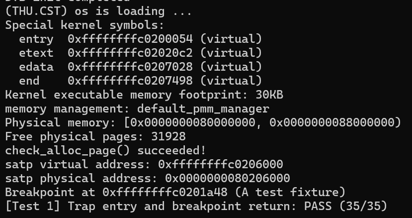

# Lab3 实验报告

## 1. 本阶段范围

负责成员：李易桐，学号 2412933。

本阶段完成：

1. `kern/trap/trapentry.S` 的 `RESTORE_ALL`。
2. `kern/trap/trapentry.S` 的 `__alltraps` 待填部分。
3. 将 Lab2 的 `page_init()` 和 Best-Fit 实现迁入 Lab3 对应位置。
4. 衔接内存地址上限、启动页表和 QEMU 启动方式。
5. 准备并运行 A 的独立检查。

## 2. 整体执行逻辑

内核启动后初始化设备树、控制台和物理内存管理，将 `stvec` 设置为 `__alltraps`。进入 Trap 时，处理器记录返回地址、原因和状态，汇编入口再通过 `SAVE_ALL` 将软件需要保留的现场保存到栈上的 Trap frame。

`__alltraps` 将当前栈指针作为参数放入 `a0`，调用 C 语言接口 `trap(struct trapframe *tf)`。C 层根据原因处理中断或异常，必要时更新 Trap frame 中的返回地址。C 函数返回后，执行流进入 `__trapret`，由 `RESTORE_ALL` 恢复现场，再执行 `sret`。

## 3. 核心实现与 spec

### 3.1 `RESTORE_ALL`

输入为当前 `sp` 指向的 Trap frame。要求恢复返回所需状态及可写通用寄存器，并与既有 `SAVE_ALL`、`struct trapframe` 的布局严格一致，不改变这些既有接口。

Trap frame 包含 32 个通用寄存器槽位和 4 个 CSR 记录，RV64 下共 288 字节。第 32、33 个槽位分别对应 `sstatus`、`sepc`，第 2 个槽位保存分配 Trap frame 之前的 `sp`。

实现先用临时寄存器读出并写回 `sstatus`、`sepc`，再恢复通用寄存器，最后恢复 `sp`。将 `sp` 放在最后，是因为其他加载仍需用当前 Trap frame 地址定位。`x0` 是常量零寄存器，不执行恢复；保存的异常原因和附加地址供诊断使用，不需要写回作为返回现场。

### 3.2 `__alltraps`

要求在 `SAVE_ALL` 之后将正确的 Trap frame 地址传给 `trap()`，且返回后当前 `sp` 仍能定位原 Trap frame。

实现使用 `mv a0, sp` 传参，再用 `jal trap` 调用 C 函数。调用前已保存原 `ra`，因此函数调用对 `ra` 的修改可在返回流程中恢复。C 函数返回后顺序进入 `__trapret`。

### 3.3 Lab2 衔接

从小组实际提交的 Lab2 代码迁入 `page_init()`，保留设备树检查、地址换算、页描述符容量检查、保留页初始化和可用页登记。迁移后的 Lab3 保留 `local_intr_save()` / `local_intr_restore()` 包装，不用 Lab2 的直接调用版本覆盖它们。

原 `page_init()` 使用 `PHYSICAL_MEMORY_END`，而 Lab3 头文件未提供该宏，因此补入原有上限 `0x88000000`。保留 Lab3 的原子位操作定义。

Best-Fit 仅迁入分配器实现及 manager 定义，Lab3 原有 `basic_check()`、`best_fit_check()` 函数体保持原样；默认启动管理器仍为课程框架中的 `default_pmm_manager`。

## 4. 启动兼容问题与处理

启动页表迁入 Lab2 已使用的低地址恒等映射，使启用 `satp` 后仍能继续取启动代码指令，同时保留 Lab3 对精确栈顶地址的设置。

在本次实际验证环境中，使用框架原来的 `-device loader` 参数时，OpenSBI 日志显示 `Domain0 Next Address` 为 `0x0`，内核未开始执行。使用 `-kernel bin/ucore.img` 后，入口为 `0x80200000`，内核初始化及 A 专项测试通过。

因此将 Makefile 的运行、调试、测试目标及 `tools/grade.sh` 的 QEMU 加载参数改为 `-kernel`。评分脚本的测试用例、断言、匹配条件、超时和分值未改。诊断日志保存于 `materials/A/assistant-loader-diagnosis.log`。

### 4.1 本机验证中的问题与修复

1. 专项脚本未自动找到工具：通过参数明确指定编译器前缀和 QEMU 路径。
2. make 反复提示文件修改时间位于未来：在 code 目录更新文件时间戳后重新构建。
3. 汇编器报 unknown CSR `sbadaddr`：在 trapentry.S 顶部添加 `#define sbadaddr stval`，保留 SAVE_ALL 的原有代码和 Trap frame 布局。

## 5. 验证结果与范围

本机验证环境为 WSL，实际工具版本如下：

- 编译器：riscv64-unknown-elf-gcc 15.1.0（g1b306039ac4）。
- 模拟器：QEMU 7.0.0。
- 固件：OpenSBI 1.0，以本次启动日志为依据。

在 code 目录执行：

    set -o pipefail
    python3 -u tools/check_module_a.py --qemu /opt/qemu/bin/qemu-system-riscv64 --gccprefix "$HOME/compiler-env/riscv-elf-toolchains/bin/riscv64-unknown-elf-" 2>&1 | tee ../report/materials/A/local-a-check.log

本机实际输出包含：

    memory management: default_pmm_manager
    check_alloc_page() succeeded!
    [Test 1] Trap entry and breakpoint return: PASS (35/35)
    MODULE A CHECK: PASS

本机完整日志见 `materials/A/local-a-check.log`。代码准备阶段的日志另见 `materials/A/assistant-a-check.log`，本节环境及结果以本机记录为准。

专项脚本在临时副本中使用测试用异常处理函数，调用课程提供的寄存器上下文与断点返回探针；探针设置被测寄存器后触发断点，再比较恢复值。外围 shim 保存探针调用者的 callee-saved 寄存器，原探针文件未修改。

本次验证覆盖物理内存管理启动自检，以及 A 的主要入口、现场恢复和断点返回链路。35/35 为该项测试分值；正式中断、异常处理及整组最终评分仍待后续验证。

本机专项测试截图：

## 6. A 相关思考与原理

`stvec` 入口要求四字节对齐，地址低两位因此可以用于模式编码。旧的直接入口地址低两位为 `00`，在新编码下仍对应 Direct 模式，维持直接入口语义的兼容。

Trap 现场保存与进程上下文切换都涉及寄存器状态管理，但本阶段的 Trap 返回不等于发生进程调度。当前实验验证的是一次陷入及返回，尚未实现完整进程切换、用户地址空间切换和多核同步。

---

## 7. B 部分：中断处理 `interrupt_handler()`

负责成员：洪若曦 学号：2413524。

### 7.1 任务范围

部分负责功能模块二的"中断"这一支：

1. `kern/trap/trap.c` 中的 `void interrupt_handler(struct trapframe *tf)`：时钟中断、软件中断、外部中断提示与未知中断兜底。
2. 配套任务：最终代码合并、整组回归测试与评分、全部 prompt 汇总、中断开关相关分析。

异常这一支 `exception_handler()`（非法指令、断点、指令长度与 `epc` 推进）由 C 负责，本部分不实现。

### 7.2 背景知识

**Trap 的两类**：RISC-V 把所有控制转移事件统称 Trap。中断（Interrupt）是异步事件，由外部设备触发，与当前执行到哪条指令无关（时钟、磁盘完成）；异常（Exception）是同步事件，由当前这条指令触发（非法指令、断点、访问坏地址）。`trap_dispatch()` 用 `scause` 最高位区分：`(intptr_t)tf->cause < 0` 即最高位为 1，走 `interrupt_handler()`；否则走 `exception_handler()`。

**陷入时硬件自动做的事**：跳转到 `stvec` 之前，硬件把被打断指令地址写入 `sepc`、把原因编码写入 `scause`、把附加信息写入 `stval`，并把旧 `sstatus.SIE` 存进 `SPIE` 后清零 `SIE`（处理期间不再被中断打断），把旧特权级存入 `SPP`，最后 `pc = stvec`。

**`scause` 编码**：bit63=1 表示中断，低位才是中断号。S 态中断号在 `libs/riscv.h` 定义为 `IRQ_S_SOFT=1`、`IRQ_S_TIMER=5`、`IRQ_S_EXT=9`。

**时钟中断为什么要"自己重新武装自己"**：RISC-V S 态时钟中断不是周期性自动重复的。OpenSBI 的 `sbi_set_timer(时刻)` 只保证在 `time` 寄存器涨到该时刻时触发**一次**中断。因此每次时钟中断处理里必须再调一次 `clock_set_next_event()`（= `sbi_set_timer(get_cycles()+timebase)`），否则整个系统只响一次时钟中断。QEMU 上 `time` 频率 10MHz，`timebase=100000` 即每 10ms 一次，每秒约 100 次。

### 7.3 实现说明

在 `trap.c` 的 `//lab3 function2 YOUR CODE` 处新增 `interrupt_handler()`：

- **取中断号**：`int irq = (int)(tf->cause & 0x7FFFFFFFFFFFFFFFULL);` 统一屏蔽 bit63。这样真实时钟中断 `cause=0x8000000000000005` 得到 5，评分用例直接传入的 `cause=15`（不带 bit63）得到 15，两种情况都能正确分派。
- **`IRQ_S_TIMER`(5)**：先 `clock_set_next_event()` 重武装，再 `ticks++`；当 `ticks % TICK_NUM == 0`（每 100 次≈每秒）调现成的 `print_ticks()` 打印 `100 ticks`。本分支不关机、不 panic，保证 `ticks` 能持续涨到评分要求的 200。
- **`IRQ_S_SOFT`(1)**：打印 `Supervisor software interrupt`，不做其他动作。
- **`IRQ_S_EXT`(9)**：打印一行提示，本实验不展开。
- **default（未知中断）**：先打印 `Unknown interrupt: cause %d`（irq=15 时即 `Unknown interrupt: cause 15`），再调 `print_trapframe(tf)` 打印完整寄存器现场辅助调试。

### 7.4 中断开关相关分析

- **两道中断门**：`sstatus.SIE` 是 S 态总的中断使能（bit1），`intr_enable()`/`intr_disable()` 就是置/清这一位；`sie` 寄存器是更细的按类型使能，`clock_init()` 里 `set_csr(sie, MIP_STIP)` 单独放开时钟中断。只有 `SIE=1` 且对应 `sie` 位放开，中断才真正进来。
- **`local_intr_save(x)` / `local_intr_restore(x)`**（`kern/sync/sync.h`）：先读 `SIE`，若原来开着就关中断并记下"原来开着"（返回 1）；恢复时按记录决定是否重新开。这保证了即使嵌套调用也能正确还原。
- **为什么改内存链表要包这一对**：`pmm.c` 的 `alloc_pages`/`free_pages`/`nr_free_pages` 都用 `local_intr_save` 包住对 `pmm_manager` 的调用。在空闲链表指针改到一半时若被时钟中断打断、而时钟处理路径又去分配/释放页，会破坏链表一致性。关短中断临界区即可保证这类数据结构操作的原子性。
- **`do{...}while(0)` 的作用**：把宏包成一条合法语句，使 `if/else` 里使用时不会因为大括号配对而出错（例如 `if(x) local_intr_save(a); else ...` 不会把 else 错配到宏内部）。
- **硬件的 SIE/SPIE 自动行为**：陷入 S 态时硬件自动 `SPIE=旧SIE; SIE=0`，`sret` 返回时自动 `SIE=SPIE; SPIE=1`。所以中断处理函数里不需要手动关中断——进入内核时硬件已经关了。

### 7.5 测试与评分对应

评分脚本 `tools/grade.sh` 三个用例与本部分的关系：

| 用例 | 分值 | 本部分贡献的输出串 |
|---|---|---|
| Test 1：Trap 入口/现场恢复/断点返回（A） | 35 | 无 |
| Test 2：非法指令 EPC 推进与返回（C 为主） | 25 | `Supervisor software interrupt`、`Unknown interrupt: cause 15`（B 的软件/兜底分支被测试直接调用） |
| Test 3：持续 S 态时钟中断（B） | 40 | `100 ticks`（多行）、`ticks=200`（时钟持续重武装、ticks 累加到 200） |

### 7.6 待 C 完成后补充

- C 合入 `exception_handler()` 后整树链接，在 `code/` 目录跑 `make` 与 `sh tools/grade.sh`，补 `Total Score: 100/100` 的实际输出与截图。
- 汇总 A/B/C 三人 prompt（A、本目录 `prompt_B.md`、C 的 prompt）成一节。
- 核对整份报告理论分析与截图引用。

> 说明：在 C 合入 `exception_handler()` 之前，`trap_dispatch()` 引用的 `exception_handler` 尚未定义，整树无法链接通过；本部分 `interrupt_handler()` 本身已写完并自检逻辑，待 C 代码到位后即可整体编译评分。

